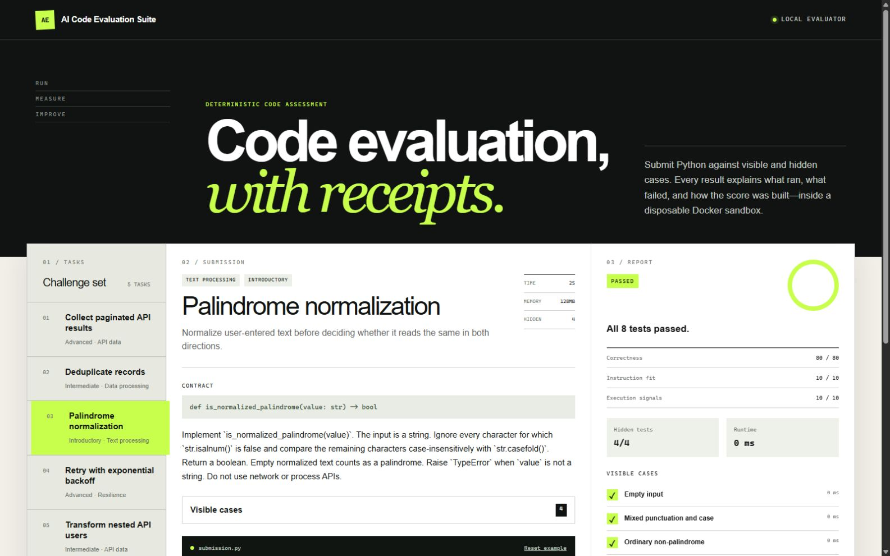
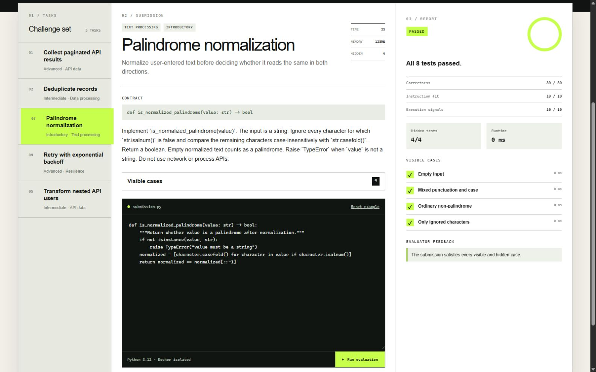
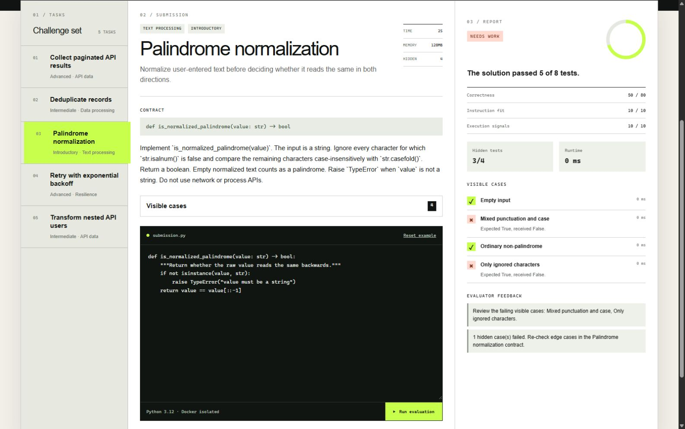
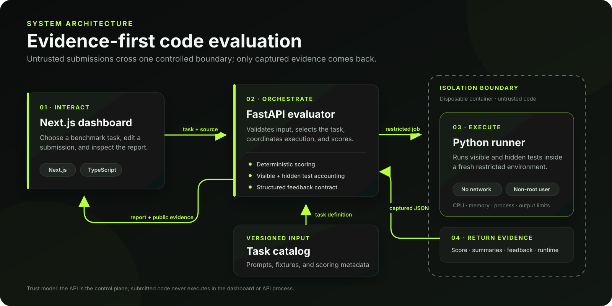

# CodeBench — AI-Assisted Code Evaluation Platform

CodeBench is an open-source multi-agent evaluation platform for testing, explaining, and iteratively improving code generation. Choose a task, run an evaluation loop with the `PlannerAgent`, `CodingAgent`, and `TestAgent`, and receive a deterministic report backed by visible and hidden tests.

Submitted code is run inside a disposable, network-disabled Docker container and is manipulated dynamically by tools using the Model Context Protocol (MCP).

This project demonstrates advanced AI systems engineering around multi-agent orchestration, MCP integration, MLOps, test isolation, and evaluation benchmarking.

## Why this matters

- **AI-generated code needs evidence, not plausibility.** The suite turns a code
  suggestion into a repeatable result backed by visible tests, hidden-test
  accounting, and captured runtime evidence.
- **Evaluation should be inspectable.** Deterministic scoring and a structured
  report make successes, failures, and tradeoffs easy to review across a UI,
  API, or CI workflow.
- **Untrusted code needs a boundary.** Submissions run in disposable,
  network-disabled containers with resource limits, while the API remains the
  trusted control plane.

## Interface preview



The desktop workspace keeps the task contract, submitted Python, and evaluation
evidence visible together.

| Passing evaluation | Actionable failure feedback |
| --- | --- |
|  |  |
| A complete `100/100` run with visible and hidden test summaries. | A `70/100` run that identifies failed cases and the next edge cases to review. |

## Sample evaluation report

A deliberately incomplete palindrome submission still produces a useful,
machine-readable result. This shortened response preserves the real score,
public failure evidence, hidden-test summary, and evaluator feedback while
omitting transport metadata for readability:

```json
{
  "task_id": "palindrome-normalization",
  "status": "completed",
  "score": 70,
  "score_breakdown": {
    "correctness": 50,
    "instruction_adherence": 10,
    "execution_signals": 10
  },
  "passed": false,
  "summary": "The solution passed 5 of 8 tests.",
  "hidden_test_summary": {
    "passed": 3,
    "failed": 1,
    "total": 4
  },
  "feedback": [
    {
      "severity": "warning",
      "message": "Review the failing visible cases: Mixed punctuation and case, Only ignored characters."
    },
    {
      "severity": "warning",
      "message": "1 hidden case(s) failed. Re-check edge cases in the Palindrome normalization contract."
    }
  ]
}
```

Hidden-test implementation details stay private; the report exposes only the
summary needed to diagnose behavior without leaking the benchmark.

## Features

- **Multi-Agent Orchestration**: Specialized agents for planning, coding, reviewing, and testing.
- **Model Context Protocol (MCP)**: Implements MCP v2 HTTP transport for local tooling.
- **MLOps Integration**: Experiment tracking with MLflow and session persistence with PostgreSQL/SQLite.
- **Robust Evaluation Tasks**: Tasks with public criteria and hidden test validations.
- **Security-First Execution**: Docker-isolated execution, security scanner agent, resource limits.
- **Benchmarking Tools**: Scripts for deterministic baseline metrics and AI performance metrics.
- **Next.js Dashboard**: Rich visual timeline for agent runs, session metrics, and tool calls.

## Architecture



The monorepo keeps browser, trusted evaluator, untrusted runtime, task content,
and shared contracts visibly separate. The API is the trusted control plane;
submitted code never executes in the dashboard or evaluator process. Read the
full [architecture and threat-model guide](docs/architecture.md).

## Project structure

```text
.
├── apps/dashboard/            # Next.js App Router UI
├── services/evaluator/        # FastAPI service and Docker orchestration
├── packages/shared-types/     # Public API TypeScript types
├── benchmarks/python/         # Five tasks and reference solutions
├── docker/runner/             # Minimal untrusted Python image
├── docs/                      # Architecture, scoring, security, roadmap
├── .github/workflows/ci.yml
└── docker-compose.yml
```

## Requirements

- Docker Desktop or a Linux Docker daemon
- Python 3.12 or newer for host-side evaluator development
- Node.js 22 or newer and npm

The evaluator image and submission runner use pinned Python 3.12 base images,
so the complete Compose workflow does not depend on host Python.

## Quick start with Docker Compose

```bash
docker compose up --build
```

Open `http://localhost:3000`. The API documentation is at
`http://localhost:8000/docs`; health is at `http://localhost:8000/health`.

Compose builds the runner image before starting the evaluator. The evaluator
has access to the Docker daemon solely to create disposable submission
containers. Stop the stack with:

```bash
docker compose down
```

## Local development

### 1. Evaluator

```bash
python -m venv .venv
```

Activate it:

```bash
# macOS / Linux
source .venv/bin/activate

# Windows PowerShell
.venv\Scripts\Activate.ps1
```

Install and build the sandbox image:

```bash
python -m pip install -e "services/evaluator[dev]"
docker build -t ai-code-evaluator-runner:local -f docker/runner/Dockerfile .
uvicorn ai_code_evaluator.api:app --reload --port 8000
```

### 2. Dashboard

In another terminal:

```bash
npm ci
npm run dashboard:dev
```

If the evaluator is not at `http://localhost:8000`, copy
`apps/dashboard/.env.example` to `apps/dashboard/.env.local` and change
`NEXT_PUBLIC_EVALUATOR_URL`.

## Example evaluation

```bash
curl -X POST http://localhost:8000/api/evaluations \
  -H "Content-Type: application/json" \
  -d '{
    "task_id": "palindrome-normalization",
    "source_code": "def is_normalized_palindrome(value):\n    normalized = [c.casefold() for c in value if c.isalnum()]\n    return normalized == normalized[::-1]\n"
  }'
```

The response includes the score and its breakdown, visible case results, hidden
passed/failed totals, runtime, output streams, and feedback. Hidden test names,
inputs, expected values, and source do not appear.

## Development checks

```bash
ruff check services/evaluator
ruff format --check services/evaluator
mypy services/evaluator/src
pytest services/evaluator/tests
npm run dashboard:lint
npm run dashboard:typecheck
npm run dashboard:test
npm run dashboard:build
```

Docker-marked tests skip when the daemon or runner image is unavailable. CI
builds the image and runs them.

## Evaluation model

The score is 80% functional correctness, 10% instruction adherence, and 10%
basic execution signals. Every signal is objective and documented; the project
does not claim that this is a complete code-quality measurement. See
[evaluation-model.md](docs/evaluation-model.md).

Benchmark quality is validated against plausible incorrect submissions, not
only reference solutions. See [benchmark-quality.md](docs/benchmark-quality.md).

## Security model

The runner disables networking, uses a non-root user and read-only mounts, drops
capabilities, prevents privilege escalation, and applies CPU, memory, PID, and
wall-clock limits. Those controls make it useful for a local demonstration, not
safe for hostile public multi-tenant operation. The Docker socket, shared
kernel, and hidden-test staging model are important residual risks. Read
[security.md](docs/security.md) before exposing the evaluator.

## API endpoints

| Method | Path | Purpose |
| --- | --- | --- |
| `GET` | `/health` | Service and runner availability |
| `GET` | `/api/tasks` | Public task catalog |
| `GET` | `/api/tasks/{task_id}` | Instructions, starter code, and visible cases |
| `POST` | `/api/evaluations` | Run a submission and return a report |

FastAPI publishes the exact OpenAPI schema at `/openapi.json`. The checked-in
schema and generated TypeScript contracts are verified for drift in CI.

## Technologies

- Python 3.12, FastAPI, Pydantic, pytest, Ruff, and mypy
- Docker and Docker Compose
- Next.js App Router, React, TypeScript, and Tailwind CSS
- Vitest, Testing Library, Biome, and GitHub Actions

## Roadmap

The current milestone intentionally stops at the evaluator MVP. Planned phases
cover broken-repository debugging benchmarks, a vendor-neutral iterative coding
agent, and persistent history/comparison features. See
[roadmap.md](docs/roadmap.md).

## Contributing and license

Read [CONTRIBUTING.md](CONTRIBUTING.md) before adding tasks or changing score
semantics. The project is available under the [MIT License](LICENSE).
