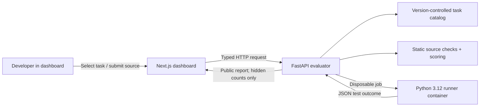
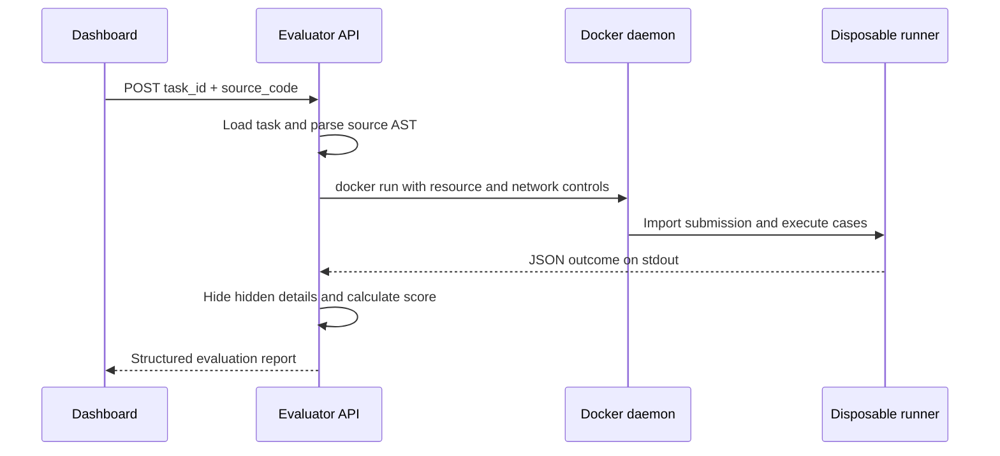

# Architecture

## System overview

AI Code Evaluation Suite is a deliberately small monorepo with one trusted
service, one untrusted execution boundary, and one browser client.

## Repository boundaries

| Area | Responsibility |
| --- | --- |
| `apps/dashboard` | Task discovery, source editing, request states, and report rendering |
| `services/evaluator` | API contracts, task loading, runner orchestration, scoring, and sanitized errors |
| `packages/shared-types` | OpenAPI document and generated browser-side TypeScript contracts |
| `benchmarks/python` | Task metadata, visible/hidden case definitions, and separate reference solutions |
| `docker/runner` | Minimal Python runtime for untrusted submissions |
| `docs` | Decisions, limitations, roadmap, and developer guidance |

## Evaluation sequence

The evaluator never imports participant source. Static analysis uses Python's
AST parser; execution occurs only in the child container.

## Deliberate MVP choices

- Task files are reloaded from disk. Five small definitions do not justify a
  cache invalidation layer.
- Results are returned directly. Persistence would add operational cost before
  comparison or history features exist.
- The Docker CLI is used instead of a long-lived SDK client. This keeps the
  orchestration path visible and easy to audit.
- Test adapters support direct calls, retry scenarios, and paginated-response
  scenarios. This is smaller and more deterministic than a general test-code
  execution framework.
- Pydantic response models are the public contract source of truth. FastAPI
  exports their OpenAPI document, and a deterministic schema generator produces
  the browser-side TypeScript types. CI fails when either generated artifact
  drifts.

## Trust boundaries

The API, task catalog, harness, and Docker daemon are trusted. Submitted source
is untrusted. Docker is the execution boundary, but the Docker daemon socket is
high privilege; only the trusted evaluator container receives it. See
[security.md](security.md) for protections and remaining risks.
