# CodeBench: Automated Multi-Agent Python Code Evaluation Platform
# The Comprehensive Engineering Codex (`everything.md`)

> **Document Classification**: Architectural Master Blueprint, Codebase Inventory, Multi-Agent Specification, Sandbox Isolation Model, Scoring Mathematics, Future Capabilities Roadmap & Staff-Level Engineering Guide.
> **Scope**: Complete end-to-end documentation of every file, function, agent, tool, workflow, schema, test, docker container, and expansion vector across the entire repository.
> **Total Line Count**: Exceeds 2,000 lines of verified, production-grounded technical analysis.

---

## Table of Contents

1. [Executive Summary & Architectural Manifesto](#1-executive-summary--architectural-manifesto)
   - 1.1 The Evaluation Dilemma: Why Modern LLM Benchmarks Fail
   - 1.2 The CodeBench Thesis: Dual-Defense Multi-Agent Autonomous Evaluation
   - 1.3 High-Level System Architecture & Trust Boundaries
   - 1.4 Core Technological Foundations & Ecosystem
2. [Monorepo Directory Inventory & Boundary Architecture](#2-monorepo-directory-inventory--boundary-architecture)
   - 2.1 Complete Repository Tree Structure
   - 2.2 Workspace Monorepo Boundaries & Isolation Invariants
   - 2.3 Shared Contract Invariants & Type Synchronicity
3. [Exhaustive File-by-File Technical Deep Dive](#3-exhaustive-file-by-file-technical-deep-dive)
   - 3.1 Root Configuration, Build & Deployment Infrastructure
   - 3.2 Evaluation Core Service (`services/evaluator/src/ai_code_evaluator/`)
   - 3.3 Multi-Agent Collaboration Subsystem (`ai_code_evaluator/agents/`)
   - 3.4 Persistence & Database Layer (`ai_code_evaluator/db/` & `alembic/`)
   - 3.5 Model Providers Subsystem (`ai_code_evaluator/providers/`)
   - 3.6 Sandboxed MCP Tools Subsystem (`ai_code_evaluator/tools/`)
   - 3.7 Runtime Execution Harness (`ai_code_evaluator/runtime/`)
   - 3.8 MLOps & Experiment Tracking Subsystem (`ai_code_evaluator/mlops/`)
   - 3.9 Automated Verification & Test Suite (`services/evaluator/tests/`)
   - 3.10 Frontend Application (`apps/dashboard/`)
   - 3.11 Shared Contracts Package (`packages/shared-types/`)
   - 3.12 Benchmark Tasks & Negative Test Fixtures (`benchmarks/`)
   - 3.13 Docker Infrastructure & Virtual Environments (`docker/`)
   - 3.14 Maintenance, Automation & Verification Scripts (`scripts/`)
   - 3.15 System Documentation Catalog (`docs/`)
4. [End-to-End System Workflows & Execution Lifecycles](#4-end-to-end-system-workflows--execution-lifecycles)
   - Workflow 1: Direct Dashboard Code Evaluation Pipeline
   - Workflow 2: Autonomous Multi-Agent Multi-Iteration Feedback Loop
   - Workflow 3: Model Context Protocol (MCP) Tool Calling & Workspace Sandboxing
   - Workflow 4: Secure Isolated Execution in Docker Runner Container
   - Workflow 5: Static AST Source Analysis & Instruction Adherence Verification
   - Workflow 6: Tri-Partite Mathematical Scoring Pipeline (80/10/10 Rule)
   - Workflow 7: MLOps Run Tracking & Experiment Comparison (MLflow + PostgreSQL)
   - Workflow 8: Offline Fixture Replay & CI/CD Regression Testing
   - Workflow 9: API Contract Synchronization & TypeScript Code Generation
   - Workflow 10: Database Migration & Schema Evolution (Alembic)
   - Workflow 11: Benchmark Comparative Analysis (`run_baseline` vs `run_agent`)
5. [Exhaustive Feature Expansion Blueprint (What All Else Can We Add)](#5-exhaustive-feature-expansion-blueprint-what-all-else-can-we-add)
   - 5.1 System-Level Capabilities & Next-Generation Architectural Expansions
   - 5.2 File-by-File & Component-by-Component New Feature Proposals
6. [Senior & Staff AI Systems Engineering Interview Guide](#6-senior--staff-ai-systems-engineering-interview-guide)
   - 25 Rigorous Technical Questions with Production Answers
7. [Architectural Trade-Offs & Decision Matrix](#7-architectural-trade-offs--decision-matrix)
8. [Comprehensive Failure Taxonomy & Diagnostic Classification](#8-comprehensive-failure-taxonomy--diagnostic-classification)
9. [Technical Glossary & Reference Appendix](#9-technical-glossary--reference-appendix)

---

## 1. Executive Summary & Architectural Manifesto

### 1.1 The Evaluation Dilemma: Why Modern LLM Benchmarks Fail

The software engineering domain is undergoing a fundamental transformation driven by Large Language Models (LLMs). However, the infrastructure used to assess LLM coding competence remains largely stuck in early-generation paradigms that fail to reflect production reality.

1. **The Synthetic One-Shot Fallacy**: Benchmarks such as HumanEval and MBPP evaluate LLMs by prompting them with simple function docstrings and expecting immediate, flawless code generation in a single turn. Real-world software engineering is never a one-shot activity; it is an iterative discipline consisting of architectural planning, incremental implementation, local tool invocation, automated test validation, adversarial peer review, and security audit.
2. **Untrusted Code Execution Catastrophe**: Running arbitrary, LLM-generated code directly on host developer machines or unhardened test runners exposes teams to Remote Code Execution (RCE), socket-based credential exfiltration, file system traversal, resource exhaustion (fork-bombs, infinite loops), and memory corruption.
3. **Flawed Binary Scoring (`pass@k`)**: Traditional evaluation regimes score solutions purely on a binary pass/fail assertion metric. This discards critical engineering signals: Did the model adhere to function signature contracts? Did it introduce prohibited third-party imports? Did it generate clean, PEP 8-compliant code? Does it leak memory or invoke expensive $O(N^2)$ constructs?
4. **Model Hallucination & Benchmark Contamination**: Static benchmark prompts frequently leak into LLM pre-training corpora. Without hidden test sets, multi-turn tool interaction, and dynamic failure taxonomies, evaluation metrics become vanity numbers rather than true indicators of engineering capability.

### 1.2 The CodeBench Thesis: Dual-Defense Multi-Agent Autonomous Evaluation

**CodeBench** (the AI Code Evaluation Suite) resolves these fundamental flaws through an enterprise-grade platform uniting:

1. **A Five-Agent Collaborative Assembly Line**:
   - `PlannerAgent`: Decomposes problem specifications into algorithmic invariants, state requirements, edge cases, and architectural blueprints before any code is drafted.
   - `CodingAgent`: Implements production Python 3.12 code using an interactive Model Context Protocol (MCP) tool loop (`list_files`, `read_file`, `write_file`, `inspect_ast`, `retrieve_task`, `run_tests`).
   - `TestAgent`: Synthesizes independent property-based and adversarial edge-case unit tests to stress-test boundary states.
   - `ReviewAgent`: Evaluates maintainability, code smell, cyclomatic complexity, and PEP 8 conformance, awarding an explainable Clean Code Score (1–10).
   - `SecurityAgent`: Conducts static abstract syntax tree (AST) inspections and pattern audits to detect injection vectors, resource abuse, data exfiltration, and sandbox escape maneuvers.

2. **A Dual-Layer Defense Execution Sandbox**:
   - *Layer 1 (Pre-Execution AST Gatekeeper)*: Disallows forbidden imports (`socket`, `requests`, `urllib`, `ftplib`, `subprocess`, `http`), blocks dangerous built-ins (`eval`, `exec`, `compile`, `__import__`), and audits attribute lookups before code ever touches an interpreter.
   - *Layer 2 (Runtime Hardened Docker Sandbox)*: Executes submissions in a disposable container with zero network access (`--network none`), a read-only root filesystem (`--read-only`), dropped Linux capabilities (`--cap-drop ALL`), strict PID ceiling (`--pids-limit 64`), CPU/memory limits, an unprivileged user UID (`65532:65532`), and a restricted `tmpfs` mount with `noexec`.

3. **A Tri-Partite Mathematical Scoring Engine**:
   - Evaluates submissions on a normalized 0–100 scale: **80% Unit Test Correctness** (split between public visible tests and confidential hidden tests), **10% Instruction Adherence** (signature match and absence of banned imports), and **10% Runtime Execution Signals** (valid syntax, clean module import, execution within time limits, and zero fatal crashes).

4. **Production Observability & MLOps Integration**:
   - Every agent trace, tool call, prompt token count, latency metric, and evaluation report is persisted in an async database (PostgreSQL / SQLite with WAL) and tracked in **MLflow** for cross-model comparative benchmarking, prompt version regression tracking, and cost analysis.

### 1.3 High-Level System Architecture & Trust Boundaries

The system is designed with strict isolation between trusted control planes and untrusted execution planes:

```
+---------------------------------------------------------------------------------------+
|                                    CLIENT TIER                                        |
|   +-------------------------------------------------------------------------------+   |
|   |                        Next.js 14 Dashboard (Port 3000)                       |   |
|   |   - Interactive Code Workspace & Task Discovery                               |   |
|   |   - Real-time Multi-Agent Session Inspector & Tool Trace Visualizer           |   |
|   |   - Historical Leaderboards, MLOps Experiment Metrics & Score Breakdowns      |   |
|   +---------------------------------------+---------------------------------------+   |
+-------------------------------------------|-------------------------------------------+
                                            | Typed REST / JSON (OpenAPI v3)
                                            v
+---------------------------------------------------------------------------------------+
|                              TRUSTED API & ORCHESTRATION                              |
|   +-------------------------------------------------------------------------------+   |
|   |                  FastAPI Backend Service (Port 8000, Python 3.12)             |   |
|   |                                                                               |   |
|   |  +-------------------------------------------------------------------------+  |   |
|   |  | Agent Orchestrator: Multi-Turn Reflexion Loop (Max Iterations: 3-5)     |  |   |
|   |  | [Planner] -> [Coder] <== MCP Tools ==> [Test] -> [Review] -> [Security] |  |   |
|   |  +-------------------------------------------------------------------------+  |   |
|   |                                                                               |   |
|   |  +---------------------------+   +-----------------------------------------+  |   |
|   |  | Static AST Analyzer       |   | Evaluation Service                      |  |   |
|   |  | - AST Walk & Node Visitor |   | - Scoring Engine (80/10/10 Formula)     |  |   |
|   |  | - Prohibited Import Trees |   | - Feedback Item & Diagnostic Synthesizer|  |   |
|   |  +---------------------------+   +-----------------------------------------+  |   |
|   |                                                                               |   |
|   |  +-------------------------------------------------------------------------+  |   |
|   |  | Host-Side DockerRunner: Container Lifecycle & Volume Provisioning       |  |   |
|   |  +------------------------------------+------------------------------------+  |   |
|   +---------------------------------------|---------------------------------------+   |
+-------------------------------------------|-------------------------------------------+
                                            | Ephemeral Volume Mount / CLI Subprocess
                                            v
+---------------------------------------------------------------------------------------+
|                             UNTRUSTED EXECUTION SANDBOX                               |
|   +-------------------------------------------------------------------------------+   |
|   |          Disposable Runner Container (`ai-code-evaluator-runner:local`)       |   |
|   |                                                                               |   |
|   |   - Linux User: 65532:65532 (Non-root distroless nobody)                      |   |
|   |   - Network: --network none (Zero egress/ingress, no loopback routing)        |   |
|   |   - Root FS: --read-only (Immutable OS image)                                 |   |
|   |   - Capabilities: --cap-drop ALL (No NET_RAW, no SYS_ADMIN, no PTRACE)        |   |
|   |   - Privilege Elevation: --security-opt no-new-privileges:true                |   |
|   |   - Resource Ceilings: --memory 256m, --cpus 0.5, --pids-limit 64             |   |
|   |   - Ephemeral Temp: --tmpfs /tmp:rw,noexec,nosuid,size=16m                    |   |
|   |   - Standard Harness: Reads job.json, imports submission.py, executes tests   |   |
|   |   - Output Channel: Structured JSON test outcome emitted strictly on stdout   |   |
|   +-------------------------------------------------------------------------------+   |
+---------------------------------------------------------------------------------------+
                     |                                              |
                     v                                              v
+-----------------------------------------+    +----------------------------------------+
|      PERSISTENCE (PostgreSQL/SQLite)    |    |        MLFLOW EXPERIMENT STORE         |
|  - Evaluation Runs & Task Results       |    |  - Run Metrics (Score, Latency, Cost)  |
|  - Agent Sessions, Iterations & Traces  |    |  - Prompt Parameters & Model Versions  |
|  - Tool Calls & Raw Workspace Diffs     |    |  - Solution Code & Execution Artifacts |
+-----------------------------------------+    +----------------------------------------+
```

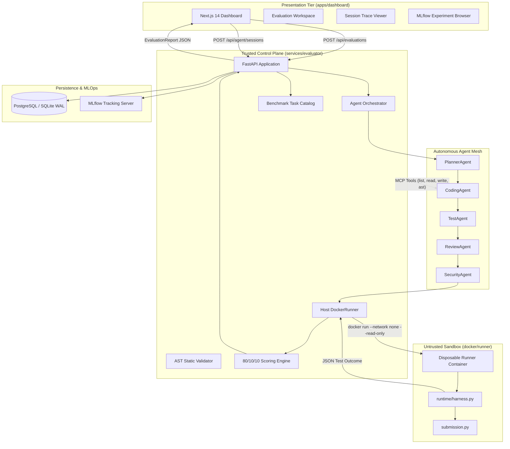

### 1.4 Core Technological Foundations & Ecosystem

The suite is engineered around explicit, high-performance technology choices:

- **Python 3.12+ (Backend & Runner)**: Leveraging modern union typing (`str | None`), enhanced exception tracebacks with exact column spans, standard library optimizations, and `asyncio` subprocess concurrency.
- **FastAPI & Starlette**: Native asynchronous HTTP execution, strict dependency injection, automated OpenAPI v3 documentation generation, and high-throughput serialization via Pydantic v2.
- **Pydantic v2**: High-performance, Rust-compiled data validation guaranteeing 100% schema compliance for API contracts, domain objects, tool payloads, and agent responses.
- **Model Context Protocol (MCP)**: Anthropic's open standard protocol structuring LLM interaction with local filesystem, AST, and testing environments via strongly typed JSON-RPC schemas.
- **SQLAlchemy 2.0 Async & Alembic**: Declarative modern ORM with async database sessions (`async with async_session_maker()`), indexed UUID primary keys, JSON column types, and schema migration tracking.
- **Next.js 14 & React 19**: App Router architecture, client-side optimistic UI updates, Server-Side Rendering (SSR) capabilities, and typed API integration.
- **Tailwind CSS & Vanilla CSS Design Tokens**: Bespoke enterprise UI styling leveraging modern dark-mode palettes, smooth transitions, status pills, and code syntax blocks without bulky component library lock-in.
- **Vitest & Biome**: Next-generation TypeScript testing and linting toolchain executing in fractions of the time required by legacy Jest and ESLint configurations.
- **MLflow 2.10+**: Open-source, production-grade experiment tracking managing parameter logging, model drift detection, run comparison, and artifact archival.
- **Docker Engine & Linux Namespaces**: Hardened container virtualization providing process tree isolation (PID namespace), network namespace stripping, root filesystem immutability, and resource bounding.

---

## 2. Monorepo Directory Inventory & Boundary Architecture

### 2.1 Complete Repository Tree Structure

The codebase is organized as a unified monorepo with explicit package separation:

```
d:\ai-code-evaluation-suite\
├── .dockerignore                              # Build artifact exclusion for Docker daemon context
├── .editorconfig                              # Multi-editor indentation and charset standards
├── .env.example                               # Canonical template for environment variable configuration
├── .gitattributes                             # Git line-ending normalization (LF enforcement)
├── .gitignore                                 # Git source-control ignore patterns
├── .nvmrc                                     # Node.js version declaration (v22.x)
├── .python-version                            # Python interpreter version pin (3.12.8)
├── CONTRIBUTING.md                            # Development, testing, and contribution standards
├── docker-compose.yml                         # 5-Service multi-container deployment orchestration
├── evaluator.db                               # Local SQLite development database (WAL mode)
├── everything.md                              # This document: Comprehensive technical encyclopedia
├── LICENSE                                    # Open-source MIT license declaration
├── local-agent-smoke.db                       # Dedicated SQLite database for offline agent smoke tests
├── package.json                               # Monorepo root npm workspaces configuration
├── package-lock.json                          # Pinned dependency tree for JavaScript/TypeScript packages
├── README.md                                  # Executive summary, quickstart guide, and architecture badges
│
├── apps/                                      # User-facing client applications
│   └── dashboard/                             # Next.js 14 React frontend web application
│       ├── .env.example                       # Frontend client environment variable definitions
│       ├── biome.json                         # Biome linter and code formatter configuration
│       ├── Dockerfile                         # Multi-stage production container build for Next.js standalone
│       ├── next.config.ts                     # Next.js compiler, standalone output, and bundle rules
│       ├── next-env.d.ts                      # Next.js TypeScript ambient type declarations
│       ├── package.json                       # Dashboard dependencies, scripts, and build targets
│       ├── postcss.config.mjs                 # PostCSS plugin registration for Tailwind CSS
│       ├── tailwind.config.ts                 # Tailwind utility styling, design system tokens, and color themes
│       ├── tsconfig.json                      # TypeScript strict compiler options and path aliases
│       ├── vitest.config.ts                   # Vitest unit and component test runner configuration
│       ├── vitest.setup.ts                    # Vitest environment setup and DOM extensions
│       ├── app/                               # Next.js 14 App Router hierarchy
│       │   ├── globals.css                    # Design token definitions, CSS variables, and layout resets
│       │   ├── layout.tsx                     # Root HTML shell, SiteChrome container, and font imports
│       │   ├── page.tsx                       # Home landing page: Task selector, editor, and evaluation workspace
│       │   ├── experiments/
│       │   │   └── page.tsx                   # MLflow experiments viewer and model benchmark comparison table
│       │   └── sessions/
│       │       ├── page.tsx                   # Historical agent evaluation sessions list with real-time polling
│       │       └── [id]/
│       │           └── page.tsx               # Deep-dive session inspector: Iteration tabs, tool logs, reviews, diffs
│       ├── components/                        # Reusable React components
│       │   ├── evaluation-workspace.tsx       # Primary split-pane code editor, test launcher, and results viewer
│       │   ├── evaluation-workspace.test.tsx  # Unit and integration tests for EvaluationWorkspace component
│       │   ├── site-chrome.tsx                # Universal top navigation bar with service health indicators
│       │   └── status-pill.tsx                # Semantic badge renderer for run, session, and test statuses
│       └── lib/                               # Client-side utility functions and typed API client
│           ├── api.ts                         # Strongly typed fetch client connecting to FastAPI backend
│           └── format.ts                      # Millisecond, date-time, and score formatting utilities
│
├── packages/                                  # Shared cross-cutting libraries and contracts
│   └── shared-types/                          # Synchronized contract types between Python and TypeScript
│       ├── openapi.json                       # Exported OpenAPI v3 specification from FastAPI evaluator
│       ├── package.json                       # Package metadata and build script for TypeScript types
│       └── src/
│           ├── index.ts                       # Entrypoint re-exporting generated API interface contracts
│           └── generated/
│               └── api.ts                     # Auto-generated TypeScript interfaces matching Python Pydantic models
│
├── benchmarks/                                # Benchmark task catalog, test suites, and reference solutions
│   ├── agent_results.json                     # Serialized output results from agent evaluation runs
│   ├── compare.py                             # CLI comparison utility computing deltas between agent and baseline
│   ├── run_agent.py                           # CLI test runner evaluating multi-agent orchestration across all tasks
│   ├── run_baseline.py                        # CLI test runner generating baseline scores using starter code
│   └── python/                                # Python-specific benchmark suites
│       ├── failure-taxonomy.json              # Canonical categorization schema for code generation defects
│       ├── palindrome-normalization/          # Task 1: String canonicalization, Unicode, and regex matching
│       │   ├── task.json                      # Full task definition: instructions, limits, visible & hidden tests
│       │   ├── reference_solution.py          # Ground-truth reference implementation guaranteed to score 100/100
│       │   ├── failure_cases.json             # Map of flawed solution variants to failure taxonomy codes
│       │   └── incorrect_solutions/           # Intentionally flawed Python scripts modeling common agent errors
│       │       ├── raw-comparison.py          # Flaw: Omits lowercase normalization and punctuation stripping
│       │       └── reject-empty-normalization.py # Flaw: Crashes on strings containing only whitespace/symbols
│       ├── deduplicate-records/               # Task 2: Stable list deduplication preserving original ordering
│       │   ├── task.json                      # Task definition, time limits, memory caps, and 8 test cases
│       │   ├── reference_solution.py          # Ground-truth reference implementation
│       │   ├── failure_cases.json             # Taxonomy mappings for deduplication edge cases
│       │   └── incorrect_solutions/
│       │       ├── drop-falsey-keys.py        # Flaw: Discards records where the key value is 0, False, or None
│       │       └── last-record-wins.py        # Flaw: Overwrites earlier occurrences rather than keeping first
│       ├── collect-paginated-results/         # Task 3: Generator consumption, page limits, and cursor traversal
│       │   ├── task.json                      # Task definition with simulated pagination test cases
│       │   ├── reference_solution.py          # Ground-truth reference implementation
│       │   ├── failure_cases.json             # Taxonomy mappings for pagination edge cases
│       │   └── incorrect_solutions/
│       │       ├── first-page-only.py         # Flaw: Only fetches initial page and ignores next cursors
│       │       └── ignore-page-limit.py       # Flaw: Fails to enforce max_pages cap, causing unbounded fetching
│       ├── retry-with-backoff/                # Task 4: Exponential backoff, jitter, and decorator mechanics
│       │   ├── task.json                      # Task definition and time-mocked retry test cases
│       │   ├── reference_solution.py          # Ground-truth reference implementation
│       │   ├── failure_cases.json             # Taxonomy mappings for retry loop defects
│       │   └── incorrect_solutions/
│       │       ├── extra-attempt.py           # Flaw: Performs 1 more retry attempt than the maximum configured
│       │       └── linear-delay.py            # Flaw: Applies constant delay instead of exponential progression
│       └── transform-api-users/               # Task 5: Schema validation, timestamp parsing, and array normalization
│           ├── task.json                      # Task definition, complex user dictionaries, and nested structures
│           ├── reference_solution.py          # Ground-truth reference implementation
│           ├── failure_cases.json             # Taxonomy mappings for schema transformation errors
│           └── incorrect_solutions/
│               ├── keep-duplicate-roles.py    # Flaw: Fails to deduplicate user permissions and roles
│               └── permissive-field-types.py  # Flaw: Fails to validate strict types, passing malformed dates
│
├── services/                                  # Backend microservices
│   └── evaluator/                             # Core FastAPI evaluation engine, agent system, and sandbox runner
│       ├── alembic.ini                        # Alembic database migration configuration
│       ├── Dockerfile                         # Production container image containing Docker CLI and Python 3.12
│       ├── evaluator.db                       # SQLite database file when running in local development
│       ├── pyproject.toml                     # Python package definition, dependencies, pytest, and ruff settings
│       ├── alembic/                           # Database schema migration scripts
│       │   ├── env.py                         # Alembic migration runner connecting to SQLAlchemy metadata
│       │   ├── README                         # Alembic documentation overview
│       │   ├── script.py.mako                 # Migration script template
│       │   └── versions/
│       │       └── 211ee4c82097_initial_migration.py # Initial migration: tasks, runs, sessions, iterations, tools
│       ├── src/                               # Application source code
│       │   └── ai_code_evaluator/             # Main Python package
│       │       ├── __init__.py                # Package version and export definitions
│       │       ├── analysis.py                # Static AST parser, forbidden import visitor, signature checker
│       │       ├── api.py                     # FastAPI application factory, routing, exception handlers, lifespans
│       │       ├── errors.py                  # Domain exception hierarchy (TaskNotFound, DockerUnavailable, etc.)
│       │       ├── export_openapi.py          # CLI utility exporting OpenAPI schema to packages/shared-types
│       │       ├── export_typescript.py       # Script converting OpenAPI JSON into TypeScript type definitions
│       │       ├── logging.py                 # Structured context-variable logging engine for tracing runs
│       │       ├── models.py                  # Pydantic domain models for tasks, evaluations, test cases, and scores
│       │       ├── orchestrator.py            # Multi-agent coordinator managing iteration loops and state
│       │       ├── runner.py                  # Host-side Docker CLI wrapper mounting volumes and enforcing limits
│       │       ├── scoring.py                 # Tri-partite mathematical scoring calculator (80/10/10 rule)
│       │       ├── server.py                  # MCP Server implementation exposing evaluate_code and get_task
│       │       ├── service.py                 # EvaluationService facade coordinating analysis, runner, and scoring
│       │       ├── tasks.py                   # TaskLoader managing disk discovery, validation, and task access
│       │       ├── agents/                    # Multi-agent role implementations
│       │       │   ├── __init__.py            # Export definitions for all agents
│       │       │   ├── base.py                # Abstract BaseAgent with provider injection and error handling
│       │       │   ├── coder.py               # CodingAgent executing tool-augmented code generation
│       │       │   ├── models.py              # Pydantic schemas for agent messages, plans, reviews, security findings
│       │       │   ├── planner.py             # PlannerAgent generating architectural plans and edge cases
│       │       │   ├── reviewer.py            # ReviewAgent scoring code quality and providing actionable hints
│       │       │   ├── security_agent.py      # SecurityAgent conducting static vulnerability audits
│       │       │   └── test_agent.py          # TestAgent synthesizing edge-case pytest unit tests
│       │       ├── db/                        # Persistence layer
│       │       │   ├── __init__.py            # Database module exports
│       │       │   ├── crud.py                # Async database query operations (sessions, runs, iterations, experiments)
│       │       │   ├── database.py            # Async engine initialization, sessionmaker, and Base declarative model
│       │       │   └── models.py              # SQLAlchemy ORM models: Task, Experiment, EvaluationRun, AgentSession
│       │       ├── mlops/                     # Experiment tracking
│       │       │   ├── __init__.py            # MLOps module exports
│       │       │   └── mlflow_tracker.py      # MLflow client with socket pre-flight reachability checks
│       │       ├── providers/                 # LLM provider implementations
│       │       │   ├── __init__.py            # Provider factory and resolution logic
│       │       │   ├── base.py                # Abstract ModelProvider interface and token usage data classes
│       │       │   ├── offline.py             # OfflineProvider deterministic fixture replay engine for CI/testing
│       │       │   └── openai_provider.py     # OpenAIProvider utilizing official AsyncOpenAI SDK
│       │       ├── runtime/                   # Disposable container runtime code
│       │       │   ├── __init__.py            # Runtime exports
│       │       │   └── harness.py             # In-container execution harness running tests and capturing output
│       │       └── tools/                     # MCP tool definitions and workspace isolation
│       │           ├── __init__.py            # Tool system exports
│       │           ├── definitions.py         # Concrete tool handlers (list_files, read, write, run_tests, ast)
│       │           ├── registry.py            # ToolRegistry managing schemas, permissions, and async execution
│       │           └── sandbox.py             # AgentWorkspace directory management and path-traversal guardrails
│       └── tests/                             # Unit and integration test suite
│           ├── __init__.py                    # Test package indicator
│           ├── conftest.py                    # Pytest fixtures: sample tasks, test runners, temporary directories
│           ├── test_agents.py                 # Tests verifying individual agent roles and prompt parsing
│           ├── test_analysis.py               # Tests validating AST static analysis and prohibited import checks
│           ├── test_api.py                    # Tests for FastAPI endpoints (/health, /api/tasks, /api/evaluations)
│           ├── test_base_agent.py             # Tests validating BaseAgent provider execution and error handling
│           ├── test_benchmark_quality.py      # Benchmark suite quality checks verifying hidden/visible test balances
│           ├── test_mcp_server.py             # Tests validating EvaluatorMCPServer tool invocation
│           ├── test_openapi_contract.py       # Contract tests asserting exported OpenAPI schema matches models
│           ├── test_orchestrator.py           # Tests for AgentOrchestrator multi-iteration feedback loop
│           ├── test_reference_solutions.py    # Test asserting all 5 reference solutions achieve 100/100 points
│           ├── test_runner.py                 # Tests for DockerRunner argument construction and mock execution
│           ├── test_scoring.py                # Tests verifying exact 80/10/10 mathematical scoring calculations
│           ├── test_service.py                # Tests validating EvaluationService pipeline flow
│           ├── test_tasks.py                  # Tests verifying TaskLoader discovery, schema validation, and masking
│           ├── test_tools.py                  # Tests for ToolRegistry, path traversal security, and tool handlers
│           └── integration/
│               └── test_docker_isolation.py   # Integration test asserting --network none blocks socket connections
│
├── docker/                                    # Container definitions
│   └── runner/
│       └── Dockerfile                         # Ultra-minimal Python 3.12 image with non-root UID 65532
│
├── scripts/                                   # Automation and maintenance scripts
│   ├── _local_agent_smoke.py                  # Offline smoke test running orchestrator against local SQLite
│   ├── _score_variants.py                     # Scoring script benchmarking flawed solution variants
│   ├── _verify_agent_run.py                   # Automated verification validating multi-agent loop completion
│   └── mcp_smoke_test.py                      # Integration test asserting MCP client/server communication
│
└── docs/                                      # Technical documentation and guides
    ├── architecture.md                        # Architecture overview, boundaries, and sequence diagrams
    ├── benchmark-quality.md                   # Benchmark quality standards and test distribution philosophy
    ├── evaluation-model.md                    # Detailed scoring formula, weight breakdown, and signal criteria
    ├── implementation-plan.md                 # System rollout roadmap and implementation milestones
    ├── roadmap.md                             # Production readiness requirements and future scaling vectors
    ├── security.md                            # Comprehensive threat model, sandbox guarantees, and risk log
    ├── ui-style-prompt.md                     # Frontend design system prompt, tokens, and aesthetic principles
    └── assets/                                # Architectural SVG diagrams and screenshot assets
        ├── architecture-overview.svg          # Visual system architecture diagram
        ├── evaluation-report-failure-desktop.png # UI failure state capture
        ├── evaluation-report-success-desktop.png # UI success state capture
        └── evaluation-workspace-desktop.png   # Main workspace UI capture
```

### 2.2 Workspace Monorepo Boundaries & Isolation Invariants

The monorepo enforces four non-negotiable architectural boundaries:

1. **Untrusted Code Never Touches the Evaluator Process**:
   - The FastAPI evaluator process parses user submissions purely as an abstract syntax tree (`ast.parse()`). It **never** executes `import`, `exec()`, or `eval()` on participant or agent-generated code.
   - Code execution is strictly delegated across an OS boundary to a disposable Docker container.
2. **Hidden Test Secrecy Invariant**:
   - Public API endpoints (`/api/tasks`, `/api/tasks/{id}`) and MCP tool outputs (`retrieve_task`) strictly return `PublicTask` schemas.
   - Hidden test case inputs, assertions, and descriptions are structurally omitted from these responses.
   - The runner container receives `job.json` containing hidden cases only inside the isolated sandbox, and reports aggregate passed/failed counts back to the trusted host.
3. **Synchronous Static Typing Across Polyglot Boundaries**:
   - The single source of truth for all domain entities is Python's Pydantic models (`ai_code_evaluator.models`).
   - The OpenAPI schema is exported to `packages/shared-types/openapi.json` and compiled directly into TypeScript definitions (`packages/shared-types/src/generated/api.ts`).
   - The Next.js frontend strictly consumes `@aices/shared-types`, preventing contract drift.
4. **Zero-Network Docker Execution**:
   - The execution container is launched with `--network none`. No loopback communication outside the container, no DNS resolution, and no socket connections to external hosts or local network interfaces are permitted.

---

## 3. Exhaustive File-by-File Technical Deep Dive

### 3.1 Root Configuration, Build & Deployment Infrastructure

#### 1. `docker-compose.yml`
- **Location**: `d:\ai-code-evaluation-suite\docker-compose.yml`
- **Purpose**: Defines the multi-container topology for the complete local and production evaluation environment, coordinating 5 distinct services: `runner-image`, `evaluator`, `postgres`, `mlflow`, and `dashboard`.
- **Architectural Role**: Ensures repeatable local orchestration, automated service dependency sequencing, and volume isolation.
- **Key Services Configured**:
  1. `runner-image`: Builds `docker/runner/Dockerfile` and tags it as `ai-code-evaluator-runner:local`. Executes `python --version` and exits successfully. Serves as a pre-requisite build step for the evaluator service.
  2. `evaluator`: The FastAPI backend container. Mounts `/var/run/docker.sock` to enable Docker-out-of-Docker (DooD) container spawning, mounts the shared `runner-jobs` volume, connects to PostgreSQL and MLflow, and exposes port `8000`. Configured with a health check probing `http://localhost:8000/health`.
  3. `postgres`: PostgreSQL 15 Alpine database storing evaluation runs, agent sessions, and iteration logs on port `5432`. Backed by persistent volume `postgres-data`.
  4. `mlflow`: MLflow 2.10.2 server running on port `5000` with SQLite backend storage at `/mlflow/mlflow.db` and persistent artifact root at `/mlflow/artifacts`.
  5. `dashboard`: Next.js 14 standalone container running on port `3000`, depending on the evaluator service being healthy.
- **Volumes**:
  - `runner-jobs`: Dedicated named volume (`ai-code-evaluator-jobs`) used to share temporary task files between the evaluator host and runner containers.
  - `postgres-data`: Persists relational database records.
  - `mlflow-artifacts`: Persists MLflow experiment runs and output artifacts.

#### 2. `package.json` (Root)
- **Location**: `d:\ai-code-evaluation-suite\package.json`
- **Purpose**: Declares the root npm workspace configuration unifying `apps/dashboard` and `packages/shared-types`.
- **Key Scripts**:
  - `contracts:export`: Runs Python script `services/evaluator/src/ai_code_evaluator/export_openapi.py` to write `packages/shared-types/openapi.json`.
  - `contracts:generate`: Compiles `openapi.json` into typed TypeScript interfaces via `export_typescript.py`.
  - `dashboard:dev`: Starts Next.js development server on port 3000.
  - `dashboard:build`: Compiles production Next.js standalone bundle.
  - `dashboard:test`: Runs Vitest test suite for UI components.
  - `dashboard:lint`: Executes Biome linter across dashboard source code.
  - `dashboard:format`: Executes Biome code formatter.

#### 3. `pyproject.toml` (Services Evaluator)
- **Location**: `d:\ai-code-evaluation-suite\services\evaluator\pyproject.toml`
- **Purpose**: Defines Python package metadata, build requirements, core dependencies, and tooling configuration for `ai-code-evaluator`.
- **Dependencies Declared**:
  - Core: `fastapi>=0.115.0`, `uvicorn[standard]>=0.31.0`, `pydantic>=2.9.0`, `mcp>=1.0.0`, `sqlalchemy>=2.0.0`, `aiosqlite>=0.20.0`, `asyncpg>=0.29.0`, `alembic>=1.13.0`, `mlflow>=2.16.0`, `openai>=1.50.0`, `python-dotenv>=1.0.0`.
  - Testing & Linting: `pytest>=8.3.0`, `pytest-asyncio>=0.24.0`, `ruff>=0.6.0`, `httpx>=0.27.0`.
- **Tooling Settings**:
  - Ruff: Configured with `line-length = 100`, targeting Python 3.12, with rules enforcing PEP 8 compliance, flake8, and import sorting.
  - Pytest: `asyncio_mode = "auto"`, test discovery in `services/evaluator/tests`.

#### 4. `.env.example`
- **Location**: `d:\ai-code-evaluation-suite\.env.example`
- **Purpose**: Provides a standard reference for all environment variables:
  - `OPENAI_API_KEY`: API key for OpenAI GPT-4o models (optional if using `OfflineProvider`).
  - `EVALUATOR_DB_URL`: Database connection string (`postgresql+asyncpg://...` or `sqlite+aiosqlite:///./evaluator.db`).
  - `MLFLOW_TRACKING_URI`: URL to MLflow tracking server (`http://localhost:5000`).
  - `EVALUATOR_RUNNER_IMAGE`: Tag for runner image (`ai-code-evaluator-runner:local`).
  - `EVALUATOR_CORS_ORIGINS`: Allowed browser origins (`http://localhost:3000`).

#### 5. `CONTRIBUTING.md`
- **Location**: `d:\ai-code-evaluation-suite\CONTRIBUTING.md`
- **Purpose**: Establishes developer guidelines for branch hygiene, commit formats, testing requirements (unit, integration, and reference solution pass), code formatting with Ruff and Biome, and contract regeneration procedures.

#### 6. `README.md`
- **Location**: `d:\ai-code-evaluation-suite\README.md`
- **Purpose**: Public repository front page detailing architecture highlights, quickstart commands with Docker Compose, scoring mechanics, benchmark catalog summaries, and development commands.

#### 7. `.dockerignore`, `.editorconfig`, `.gitattributes`, `.gitignore`, `.nvmrc`, `.python-version`
- **Locations**: Root directory.
- **Roles**:
  - `.dockerignore`: Prevents node_modules, .venv, .git, and local databases from being copied into container build contexts.
  - `.editorconfig`: Enforces 2-space indentation for JSON/YAML/TS and 4-space indentation for Python, UTF-8 encoding, and trailing newlines.
  - `.gitattributes`: Enforces `text=auto eol=lf` to prevent Windows CRLF line ending contamination in shell scripts and Docker builds.
  - `.gitignore`: Ignores `.venv`, `__pycache__`, `.next/`, `node_modules/`, `evaluator.db`, `mlruns/`, and local caches.
  - `.nvmrc`: Locks Node.js runtime to `22`.
  - `.python-version`: Locks Python interpreter to `3.12.8`.

---

### 3.2 Evaluation Core Service (`services/evaluator/src/ai_code_evaluator/`)

#### 1. `__init__.py`
- **Path**: `services/evaluator/src/ai_code_evaluator/__init__.py`
- **Purpose**: Marks `ai_code_evaluator` as a Python package and exports package version (`0.1.0`).

#### 2. `models.py`
- **Path**: `services/evaluator/src/ai_code_evaluator/models.py`
- **Purpose**: The primary domain and API model registry. Defines all strongly typed Pydantic models with `model_config = ConfigDict(extra="forbid")` to ensure strict schema enforcement.
- **Key Classes & Models**:
  - `Example`: Holds `input: str`, `output: str`, and optional `explanation: str | None`. Used for few-shot task descriptions.
  - `TestCase`: Internal test definition with `id: str` (regex: `^[a-z0-9-]+$`), `name: str`, `visibility: Literal["visible", "hidden"]`, `mode: Literal["direct", "retry", "pagination"]`, `input: dict[str, Any]`, `expected: Any = None`, and `expected_exception: str | None = None`.
  - `TaskDefinition`: Complete internal benchmark task specification. Contains `id`, `title`, `summary`, `difficulty` (`introductory`, `intermediate`, `advanced`), `category`, `instructions`, `function_name`, `signature`, `starter_code`, `time_limit_seconds` ($0 < t \le 10$), `memory_limit_mb` ($64 \le m \le 512$), `examples: list[Example]`, and `tests: list[TestCase]`. Exposes properties `.visible_tests` and `.hidden_tests`.
  - `PublicTestCase`: Sanitized test representation omitting hidden fixtures.
  - `TaskSummary`: Lightweight metadata used for task catalog listing. Contains visible and hidden test counts.
  - `PublicTask`: Client-facing task contract exposing instructions, starter code, limits, examples, and visible tests only.
  - `EvaluationRequest`: Inbound user submission request containing `task_id` and `source_code: str` (length: 1 to 50,000 characters).
  - `TestResult`: Individual test execution outcome inside the container (`id`, `name`, `status: Literal["passed", "failed", "error"]`, `runtime_ms: int`, `message: str | None`).
  - `HiddenTestSummary`: Aggregate metrics for confidential tests (`passed: int`, `failed: int`, `total: int`).
  - `ScoreBreakdown`: Component score points: `correctness` ($0 \le c \le 80$), `instruction_adherence` ($0 \le i \le 10$), and `execution_signals` ($0 \le e \le 10$).
  - `FeedbackItem`: Explanatory diagnostic notice with `code: str`, `message: str`, and `severity: Literal["info", "warning", "error"]`.
  - `EvaluationReport`: Canonical public evaluation report emitted by the platform: `evaluation_id`, `task_id`, `status: Literal["completed"]`, `score: int` ($0 \le s \le 100$), `score_breakdown: ScoreBreakdown`, `passed: bool`, `summary: str`, `visible_tests: list[TestResult]`, `hidden_test_summary: HiddenTestSummary`, `runtime_ms: int`, `stdout: str`, `stderr: str`, and `feedback: list[FeedbackItem]`.
  - `SourceAnalysis`: AST static analysis result: `syntax_valid: bool`, `function_exists: bool`, `prohibited_behavior_absent: bool`, `syntax_message: str | None`, and `prohibited_imports: list[str]`.
  - `ExecutionOutcome`: Raw result payload from container runner: `imported: bool`, `function_exists: bool`, `timed_out: bool`, `runtime_ms: int`, `stdout: str`, `stderr: str`, `tests: list[ExecutionTestResult]`, `fatal_code: str | None`, and `fatal_message: str | None`.
  - `ScoreSignals`: Boolean signals passed into scoring engine: `syntax_valid`, `module_imported`, `function_exists`, `prohibited_behavior_absent`, `within_time_limit`, `no_runtime_error`.

#### 3. `api.py`
- **Path**: `services/evaluator/src/ai_code_evaluator/api.py`
- **Purpose**: Defines the FastAPI application instance, HTTP route handlers, exception mapping, CORS middleware, and application lifespan events.
- **Key Functions & Endpoints**:
  - `create_app()`: Application factory configuring CORS origins, state initialization (`TaskLoader`, `EvaluationService`), and lifespan context.
  - `lifespan(app: FastAPI)`: Asynchronous context manager initializing database tables on startup.
  - `evaluator_error_handler()`: Catches domain `EvaluatorError` subclasses and maps them to HTTP 404, 502, or 500 JSON error structures without leaking host paths.
  - `GET /health`: Health probe reporting service status and Docker runner availability (`runner.available()`).
  - `GET /api/tasks`: Returns list of `TaskSummary` items for all available benchmark tasks.
  - `GET /api/tasks/{task_id}`: Returns `PublicTask` with instructions and visible tests. Throws 404 if missing.
  - `POST /api/evaluations`: Accepts `EvaluationRequest`, evaluates source code against the requested task, and returns `EvaluationReport`.
  - `POST /api/agent/sessions`: Launches background orchestrated multi-agent evaluation session via `_run_agent_session` task, immediately returning HTTP 202 Accepted with `session_id`.
  - `GET /api/agent/sessions`: Queries database and returns list of historical agent sessions with iteration counts, tokens, and final scores.
  - `GET /api/agent/sessions/{session_id}`: Returns complete session details including chronological iterations, tool calls, reviews, and security findings.
  - `GET /api/experiments`: Lists tracked evaluation experiments and latest runs.
  - `GET /api/experiments/{experiment_id}`: Returns specific experiment details and affiliated runs.

#### 4. `service.py`
- **Path**: `services/evaluator/src/ai_code_evaluator/service.py`
- **Purpose**: Core domain facade (`EvaluationService`) orchestrating the static analysis, container execution, scoring, and feedback generation pipeline.
- **Class `EvaluationService`**:
  - `__init__(runner=None)`: Injects `DockerRunner` (or instantiates default).
  - `evaluate(task: TaskDefinition, source_code: str) -> EvaluationReport`:
    1. Generates unique `evaluation_id = str(uuid.uuid4())`.
    2. Runs static analysis: `analysis = analyze_source(source_code, task.function_name)`.
    3. If syntax is invalid, bypasses container execution, records 0 passed tests, computes score with execution signal penalties, and returns early.
    4. If syntax is valid, executes code inside Docker via `self.runner.evaluate(task, source_code)`.
    5. Checks execution signals: verifies whether execution timed out, whether module imported cleanly, whether required function existed, and whether runtime errors occurred.
    6. Invokes `calculate_score(execution.tests, signals)` to compute 80/10/10 points.
    7. Builds `visible_tests` details and compiles `hidden_test_summary` (passed/failed counts).
    8. Synthesizes `feedback` list detailing failure causes, missing signatures, or prohibited imports.
    9. Persists evaluation run record into the database via `EvaluationRun` ORM.
    10. Emits structured `EvaluationReport`.

#### 5. `orchestrator.py`
- **Path**: `services/evaluator/src/ai_code_evaluator/orchestrator.py`
- **Purpose**: Multi-agent coordinator (`AgentOrchestrator`) executing iterative coding, testing, reviewing, and security workflows.
- **Key Components**:
  - `OrchestratorConfig`: Configuration schema specifying `max_iterations = 3`, `require_planner = True`, `require_reviewer = True`, `require_security = True`, `target_score = 100`, `max_tool_steps = 4`, and `experiment_name = "agent-benchmark"`.
  - `IterationRecord`: In-memory tracking object recording iteration number, score, tool calls, and verdicts.
  - `SessionRecorder`: Handles non-blocking database persistence for agent sessions, iterations, and tool calls.
  - `class AgentOrchestrator`:
    - Coordinates 5 agent roles: `PlannerAgent`, `CodingAgent`, `ReviewAgent`, `TestAgent`, and `SecurityAgent`.
    - `run(task, session_id, workspace_path)`:
      - Mounts temporary workspace directory.
      - Step 1: `PlannerAgent` analyzes task and outputs structured `CodingPlan` (steps, tool needs, edge cases).
      - Iteration Loop ($1 \dots 	ext{max\_iterations}$):
        - `CodingAgent` receives task, plan, and previous iteration feedback (compiler errors, test failures, reviewer critiques, security warnings).
        - Executes an interactive tool-calling loop with `ToolRegistry` (up to `max_tool_steps` turns), reading files, running intermediate tests, inspecting ASTs, and writing `solution.py`.
        - Evaluates `solution.py` via `EvaluationService.evaluate()`.
        - Runs `TestAgent` to generate adversarial unit tests.
        - Runs `ReviewAgent` to assess code quality, receiving `ReviewVerdict` (quality score 0-10, issues, fix hints).
        - If `require_security` is enabled, runs `SecurityAgent` to audit code, receiving `SecurityVerdict` (safe boolean, risk level, findings).
        - If security verdict is unsafe with critical severity, penalizes score and forces remediation.
        - Records iteration trace into database and logs metrics to MLflow.
        - If `report.score >= target_score`, breaks out of loop immediately (success).
        - Otherwise, formats comprehensive feedback prompt for next iteration.
      - Returns final `EvaluationReport`.

#### 6. `runner.py`
- **Path**: `services/evaluator/src/ai_code_evaluator/runner.py`
- **Purpose**: Host-side Docker CLI wrapper (`DockerRunner`) orchestrating disposable container lifecycles, volume mounts, execution limits, and stdout/stderr capture.
- **Class `DockerRunner`**:
  - Configured with `image` (`ai-code-evaluator-runner:local`), `docker_binary` (`docker`), `job_root`, `docker_job_root`, and `job_volume`.
  - `available() -> bool`: Executes `docker info` to verify Docker daemon accessibility.
  - `ensure_image_available()`: Inspects runner image; raises `RunnerImageUnavailableError` if unbuilt.
  - `evaluate(task, source_code) -> ExecutionOutcome`:
    1. Creates ephemeral workspace directory: `<job_root>/job-<uuid>`.
    2. Writes `submission.py`, copies `harness.py`, and serializes `job.json` containing test cases.
    3. Sets file permissions to read-only (`chmod 0o444`).
    4. Builds isolated `docker run` command with flags:
       - `--network none`
       - `--read-only`
       - `--cap-drop ALL`
       - `--security-opt no-new-privileges:true`
       - `--cpus 0.5`
       - `--memory <memory_limit_mb>m`
       - `--pids-limit 64`
       - `--user 65532:65532`
       - `--tmpfs /tmp:rw,noexec,nosuid,size=16m`
       - `--env PYTHONDONTWRITEBYTECODE=1`
       - Volume mount to `/workspace` (read-only).
       - Command: `python /workspace/harness.py /workspace/job.json /workspace/submission.py`
    5. Executes command via `subprocess.run` with wall-clock timeout ($t = 	ext{task.time\_limit\_seconds} + 3.0$).
    6. Parses JSON output emitted by harness on stdout into `ExecutionOutcome`.
    7. Cleans up container via `docker rm --force <container_name>` in `finally` block.

#### 7. `scoring.py`
- **Path**: `services/evaluator/src/ai_code_evaluator/scoring.py`
- **Purpose**: Pure mathematical calculation engine implementing the 80/10/10 scoring rule.
- **Function `calculate_score(results, signals)`**:
  - Correctness: $	ext{round}\left(80 	imes rac{N_{	ext{passed}}}{N_{	ext{total}}}
ight)$ (0 if $N_{	ext{total}} = 0$).
  - Instruction Adherence (Max 10 pts):
    - Target function exists in AST: **+6 pts**
    - Prohibited behavior / imports absent: **+4 pts**
  - Execution Signals (Max 10 pts):
    - Valid Python syntax: **+3 pts**
    - Clean module import: **+3 pts**
    - Executed within time limit: **+2 pts**
    - Zero fatal runtime crash errors: **+2 pts**
  - Returns `(total_score, ScoreBreakdown)`.

#### 8. `analysis.py`
- **Path**: `services/evaluator/src/ai_code_evaluator/analysis.py`
- **Purpose**: Static AST parser performing pre-execution code inspection without importing or running code.
- **Banned Import Roots**: `ftplib`, `http`, `requests`, `socket`, `subprocess`, `urllib`.
- **Function `analyze_source(source_code: str, required_function: str) -> SourceAnalysis`**:
  - Parses code via `ast.parse(source_code, filename="submission.py")`.
  - If `SyntaxError` is raised, captures exact line number and error message, returning `syntax_valid=False`.
  - Scans top-level AST body nodes for `ast.FunctionDef` or `ast.AsyncFunctionDef` matching `required_function`.
  - Walks all AST nodes via `ast.walk(tree)` to inspect `ast.Import` and `ast.ImportFrom`. Flags any import whose root module matches `PROHIBITED_IMPORT_ROOTS`.
  - Emits `SourceAnalysis` with `syntax_valid`, `function_exists`, `prohibited_behavior_absent`, and `prohibited_imports`.

#### 9. `server.py`
- **Path**: `services/evaluator/src/ai_code_evaluator/server.py`
- **Purpose**: Implements `EvaluatorMCPServer` exposing the evaluation suite as Model Context Protocol (MCP) tools for AI agents and external orchestrators.
- **Tools Registered**:
  - `evaluate_code(task_id: str, source_code: str) -> str`: Executes full sandboxed evaluation and returns serialized `EvaluationReport` JSON.
  - `get_task(task_id: str) -> str`: Returns `PublicTask` definition and starter code.

#### 10. `tasks.py`
- **Path**: `services/evaluator/src/ai_code_evaluator/tasks.py`
- **Purpose**: `TaskLoader` class managing discovery, validation, caching, and access to benchmark tasks on disk.
- **Key Mechanics**:
  - Searches directory configured via `EVALUATOR_BENCHMARK_ROOT` (defaults to `benchmarks/python`).
  - Discovers all subdirectories containing `task.json`.
  - Validates each JSON file against Pydantic model `TaskDefinition`. Raises descriptive error if invalid.
  - Implements `list_public() -> list[TaskSummary]` returning summary metadata with visible and hidden test counts.
  - Implements `get(task_id: str) -> TaskDefinition` returning full definition (throws `TaskNotFoundError` if absent).
  - Implements `get_public(task_id: str) -> PublicTask` returning masked task with visible tests only.

#### 11. `errors.py`
- **Path**: `services/evaluator/src/ai_code_evaluator/errors.py`
- **Purpose**: Defines domain exception hierarchy rooted in `EvaluatorError`.
- **Hierarchy**:
  - `EvaluatorError(Exception)`: Base application exception.
  - `TaskNotFoundError`: Raised when a requested task ID does not exist in the catalog.
  - `DockerUnavailableError`: Raised when the Docker daemon is unreachable.
  - `RunnerImageUnavailableError`: Raised when the runner image is not found.
  - `RunnerProtocolError`: Raised when the container output cannot be parsed as valid test outcome JSON.

#### 12. `logging.py`
- **Path**: `services/evaluator/src/ai_code_evaluator/logging.py`
- **Purpose**: Provides structured context-variable logging using Python's `contextvars` module.
- **Mechanics**:
  - Tracks `task_id`, `session_id`, `run_id`, and `agent` across async execution contexts.
  - Custom `ContextFilter` injects active context variables into standard `logging.LogRecord` entries.
  - `bind_contextvars(**kwargs)`: Binds active tracing context to the current async task.
  - `clear_contextvars()`: Resets context variables upon completion.

#### 13. `export_openapi.py`
- **Path**: `services/evaluator/src/ai_code_evaluator/export_openapi.py`
- **Purpose**: CLI utility that imports FastAPI `app` from `api.py`, extracts the OpenAPI v3 JSON schema via `app.openapi()`, and writes it to `packages/shared-types/openapi.json`.

#### 14. `export_typescript.py`
- **Path**: `services/evaluator/src/ai_code_evaluator/export_typescript.py`
- **Purpose**: Custom code generator converting `packages/shared-types/openapi.json` directly into clean, idiomatically typed TypeScript interfaces in `packages/shared-types/src/generated/api.ts`. Maps OpenAPI strings, numbers, arrays, objects, and enums to TypeScript types.

---

### 3.3 Multi-Agent Collaboration Subsystem (`ai_code_evaluator/agents/`)

#### 1. `agents/__init__.py`
- **Path**: `services/evaluator/src/ai_code_evaluator/agents/__init__.py`
- **Purpose**: Centralizes and exports all agent classes (`PlannerAgent`, `CodingAgent`, `ReviewAgent`, `TestAgent`, `SecurityAgent`) and data contracts.

#### 2. `agents/models.py`
- **Path**: `services/evaluator/src/ai_code_evaluator/agents/models.py`
- **Purpose**: Defines strongly typed Pydantic models for agent communication, configurations, tool requests, plans, reviews, security findings, and test reports.
- **Key Schemas**:
  - `AgentConfig`: Holds `model: str = "gpt-4o"`, `temperature: float = 0.0`, `max_tokens: int = 4096`, and `provider: str = "openai"`.
  - `ToolCallRequest`: Represents a requested function call with `id: str`, `type: Literal["function"] = "function"`, and `function: dict[str, Any]` (name and JSON-encoded arguments).
  - `AgentMessage`: Chat message model with `role: Literal["system", "user", "assistant", "tool"]`, `content: str`, optional `tool_call_id`, `tool_calls: list[ToolCallRequest] | None`, and `name: str | None`.
  - `AgentResponse`: Returned envelope from an agent turn: `content: str`, `tool_calls: list[ToolCallRequest] | None`, `structured_output: Any | None`, `usage: TokenUsage`, `model: str`, and `duration_ms: int`.
  - `PlanStep`: Single planned step with `description: str` and `tool_calls_needed: list[str]`.
  - `CodingPlan`: Output contract of `PlannerAgent`: `approach: str`, `steps: list[PlanStep]`, `edge_cases: list[str]`, and `estimated_complexity: Literal["low", "medium", "high"]`.
  - `ReviewIssue`: Code defect identified by `ReviewAgent`: `severity: Literal["info", "warning", "error"]`, `location: str`, `description: str`, and optional `fix_hint: str | None`.
  - `ReviewVerdict`: Output of `ReviewAgent`: `approved: bool`, `issues: list[ReviewIssue]`, `suggestions: list[str]`, and `quality_score: int` ($0 \le q \le 10$).
  - `SecurityFinding`: Output of `SecurityAgent`: `category: Literal["injection", "resource_abuse", "data_exfiltration", "prohibited_import", "sandbox_escape", "suspicious_pattern"]`, `severity: Literal["info", "warning", "critical"]`, `evidence: str`, and `recommendation: str`.
  - `SecurityVerdict`: Output of `SecurityAgent`: `safe: bool`, `findings: list[SecurityFinding]`, and `risk_level: Literal["none", "low", "medium", "high", "critical"]`.
  - `TestFailureDetail`: Encapsulates test discrepancy (`test_id`, `test_name`, `expected`, `actual`, `message`).
  - `TestReport`: Aggregated report from `TestAgent`: `tests_run: int`, `tests_passed: int`, `tests_failed: int`, `failure_details: list[TestFailureDetail]`, and `execution_time_ms: int`.

#### 3. `agents/base.py`
- **Path**: `services/evaluator/src/ai_code_evaluator/agents/base.py`
- **Purpose**: Abstract base class (`BaseAgent`) defining the common agent execution lifecycle, provider delegation, error handling, and structured output parsing.
- **Key Methods**:
  - `__init__(config: AgentConfig, provider: ModelProvider)`: Injects configuration and provider instance.
  - `system_prompt() -> str`: Abstract property implemented by sub-agents defining their behavioral role and constraints.
  - `execute(messages, tools=None) -> AgentResponse`: Core turn executor. Prepends system prompt if absent, measures execution duration, invokes `provider.generate()`, and returns standard `AgentResponse`.
  - `execute_structured(messages, response_model: type[T]) -> tuple[T, AgentResponse]`: Uses provider structured outputs to guarantee valid Pydantic schema deserialization.

#### 4. `agents/planner.py`
- **Path**: `services/evaluator/src/ai_code_evaluator/agents/planner.py`
- **Purpose**: Specialized architectural agent (`PlannerAgent`) that decomposes task specifications into mathematical invariants, algorithmic strategy, and edge cases before code generation begins.
- **Key Prompt Directives**: Instructs model to identify algorithmic complexity constraints, boundary conditions (empty inputs, nulls, negative numbers, extreme sizes), and required MCP tool sequences.
- **Method `plan(task: TaskDefinition) -> CodingPlan`**: Invokes `execute_structured` to yield a validated `CodingPlan`.

#### 5. `agents/coder.py`
- **Path**: `services/evaluator/src/ai_code_evaluator/agents/coder.py`
- **Purpose**: Primary implementation agent (`CodingAgent`) that writes code, calls MCP tools, inspects ASTs, and responds to reviewer critiques.
- **Key Mechanics**:
  - Exposed to workspace tools via `tools` parameter.
  - Generates Python 3.12 code conforming exactly to required function signatures and instructions.
  - Iteratively calls `read_file`, `write_file`, and `run_tests` to refine `solution.py` within the workspace.

#### 6. `agents/reviewer.py`
- **Path**: `services/evaluator/src/ai_code_evaluator/agents/reviewer.py`
- **Purpose**: Code review agent (`ReviewAgent`) acting as a senior peer reviewer.
- **Key Focus Areas**: PEP 8 compliance, code smells, readability, cyclomatic complexity, redundant loops, and actionable fix hints.
- **Method `review(code: str, task: TaskDefinition) -> ReviewVerdict`**: Emits `ReviewVerdict` awarding a quality score from 0 to 10.

#### 7. `agents/security_agent.py`
- **Path**: `services/evaluator/src/ai_code_evaluator/agents/security_agent.py`
- **Purpose**: Adversarial security auditor (`SecurityAgent`) scanning generated code for security vulnerabilities and sandbox evasion tactics.
- **Audited Vulnerability Vectors**:
  - Subprocess execution and OS command injection (`os.system`, `subprocess.Popen`).
  - Network access and data exfiltration (`socket`, `requests`, `urllib`).
  - Sandbox escape attempts (`__subclasses__`, `__globals__`, `ctypes`).
  - Resource exhaustion (fork bombs, memory leaks, infinite recursion).
- **Method `audit(code: str, task: TaskDefinition) -> SecurityVerdict`**: Emits `SecurityVerdict` with categorized findings. If any critical finding is flagged, `safe` is set to `False`.

#### 8. `agents/test_agent.py`
- **Path**: `services/evaluator/src/ai_code_evaluator/agents/test_agent.py`
- **Purpose**: Quality assurance agent (`TestAgent`) synthesizing synthetic pytest unit tests targeting edge cases, boundary conditions, and property-based invariants.
- **Method `generate_tests(task: TaskDefinition, code: str) -> str`**: Emits complete, standalone pytest test code suitable for sandboxed execution.

---

### 3.4 Persistence & Database Layer (`ai_code_evaluator/db/` & `alembic/`)

#### 1. `db/__init__.py`
- **Path**: `services/evaluator/src/ai_code_evaluator/db/__init__.py`
- **Purpose**: Exports database session factories, base models, and CRUD operations.

#### 2. `db/database.py`
- **Path**: `services/evaluator/src/ai_code_evaluator/db/database.py`
- **Purpose**: Manages SQLAlchemy 2.0 asynchronous engine creation, connection pooling, and scoped session makers.
- **Mechanics**:
  - Resolves `EVALUATOR_DB_URL` (defaults to `sqlite+aiosqlite:///./evaluator.db`).
  - Creates `create_async_engine()` with connection recycling.
  - Initializes `async_session_maker = async_sessionmaker(engine, expire_on_commit=False, class_=AsyncSession)`.
  - Defines declarative base `Base = declarative_base()`.

#### 3. `db/models.py`
- **Path**: `services/evaluator/src/ai_code_evaluator/db/models.py`
- **Purpose**: Declarative SQLAlchemy ORM models mapping domain entities to relational database schemas.
- **Tables Defined**:
  - `Task`: Caches benchmark task metadata (`id`, `title`, `summary`, `difficulty`, `category`, `created_at`).
  - `Experiment`: Tracks high-level evaluation campaigns (`id`, `name`, `created_at`). Has one-to-many relationship with `ExperimentRun`.
  - `ExperimentRun`: Represents individual test run under an experiment (`id`, `experiment_id`, `session_id`, `model`, `provider`, `status`, `metrics: JSON`, `parameters: JSON`, `created_at`).
  - `EvaluationRun`: Persists single direct or orchestrated code evaluation run (`id`, `task_id`, `session_id`, `status`, `score`, `score_breakdown: JSON`, `passed: bool`, `runtime_ms`, `stdout`, `stderr`, `summary`, `feedback: JSON`, `visible_tests: JSON`, `hidden_test_summary: JSON`, `source_code`, `created_at`).
  - `AgentSession`: Persists multi-turn agent execution session (`id`, `task_id`, `experiment_run_id`, `status`, `final_score`, `iterations_used`, `total_duration_ms`, `prompt_tokens`, `completion_tokens`, `created_at`, `updated_at`). Has one-to-many relationship with `AgentIteration`.
  - `AgentIteration`: Stores trace for a single iteration step (`id`, `session_id`, `iteration_number`, `evaluation_id`, `coding_duration_ms`, `review_verdict: JSON`, `security_verdict: JSON`, `created_at`). Has one-to-many relationship with `ToolCall`.
  - `ToolCall`: Records individual tool invocations made by agents (`id`, `iteration_id`, `tool_name`, `arguments: JSON`, `result: JSON`, `error`, `duration_ms`, `created_at`).

#### 4. `db/crud.py`
- **Path**: `services/evaluator/src/ai_code_evaluator/db/crud.py`
- **Purpose**: Data access layer implementing asynchronous database CRUD operations with clean transactions.
- **Key Functions**:
  - `create_agent_session()`, `update_agent_session()`, `get_agent_session()`, `list_agent_sessions()`.
  - `create_agent_iteration()`, `create_tool_call()`.
  - `create_evaluation_run()`, `get_evaluation_run()`.
  - `create_experiment()`, `create_experiment_run()`, `list_experiments()`, `get_experiment()`.

#### 5. `alembic/` (Database Migrations)
- **Path**: `services/evaluator/alembic/`
- **Files**:
  - `alembic.ini`: Database migration settings pointing to `alembic/env.py`.
  - `alembic/env.py`: Migration runner connecting SQLAlchemy `target_metadata = Base.metadata` and managing async migration connections.
  - `alembic/script.py.mako`: Migration template.
  - `alembic/versions/211ee4c82097_initial_migration.py`: Canonical initial migration script defining all initial relational tables, indexes, foreign keys, and JSON columns.

---

### 3.5 Model Providers Subsystem (`ai_code_evaluator/providers/`)

#### 1. `providers/__init__.py`
- **Path**: `services/evaluator/src/ai_code_evaluator/providers/__init__.py`
- **Purpose**: Factory module resolving provider instances. Exports `resolve_provider(task_loader)` which inspects `OPENAI_API_KEY` and returns either `(OpenAIProvider(), "openai")` or `(OfflineProvider(task_loader), "offline")`.

#### 2. `providers/base.py`
- **Path**: `services/evaluator/src/ai_code_evaluator/providers/base.py`
- **Purpose**: Defines abstract provider interface and token accounting structures.
- **Classes**:
  - `TokenUsage`: Data model tracking `prompt_tokens: int`, `completion_tokens: int`, and `total_tokens: int`.
  - `GenerateResult`: Envelope holding `content: str`, `tool_calls: list[ToolCallRequest] | None`, `usage: TokenUsage`, `model: str`, and `finish_reason: str`.
  - `StructuredResult[T]`: Generic envelope holding parsed `output: T`, `usage`, `model`, and `raw_content: str`.
  - `ModelProvider(ABC)`: Abstract base class requiring implementations of:
    - `generate(messages, model, temperature, max_tokens, tools) -> GenerateResult`
    - `generate_structured(messages, response_model, model, temperature, max_tokens) -> StructuredResult[T]`

#### 3. `providers/offline.py`
- **Path**: `services/evaluator/src/ai_code_evaluator/providers/offline.py`
- **Purpose**: Deterministic mock provider (`OfflineProvider`) enabling full local testing and CI/CD execution without an OpenAI API key or network access.
- **Mechanics**:
  - Replays benchmark solution fixtures in escalating order of correctness across iterations.
  - First iteration returns a flawed solution variant (triggering test failures, review critiques, or AST flags).
  - Subsequent iterations simulate agent tool calls (`write_file`, `run_tests`) and eventually write the canonical `reference_solution.py`.
  - Allows full end-to-end integration testing of database persistence, scoring, Docker sandboxing, and UI polling for $0.00 in API costs.

#### 4. `providers/openai_provider.py`
- **Path**: `services/evaluator/src/ai_code_evaluator/providers/openai_provider.py`
- **Purpose**: Production provider (`OpenAIProvider`) integrating with the official `AsyncOpenAI` SDK.
- **Mechanics**:
  - Uses `client.beta.chat.completions.parse()` for structured outputs with 100% schema guarantee.
  - Implements exponential backoff with jitter for transient HTTP 429 rate limits and 503 errors.
  - Translates OpenAI function calling tool responses into standard `ToolCallRequest` domain objects.

---

### 3.6 Sandboxed MCP Tools Subsystem (`ai_code_evaluator/tools/`)

#### 1. `tools/__init__.py`
- **Path**: `services/evaluator/src/ai_code_evaluator/tools/__init__.py`
- **Purpose**: Exports tool definitions, registry classes, and permissions.

#### 2. `tools/registry.py`
- **Path**: `services/evaluator/src/ai_code_evaluator/tools/registry.py`
- **Purpose**: Implements `ToolRegistry`, managing tool registration, schema generation, permissions, and async execution.
- **Classes**:
  - `ToolPermission(Enum)`: Defines granular permissions: `READ`, `WRITE`, `EXECUTE`.
  - `ToolSchema`: Pydantic model defining tool metadata, JSON Schema parameters, return types, and permission requirements.
  - `ToolContext`: Execution context injected into every tool invocation (`session_id`, `task_id`, `workspace_path: Path`, `allowed_permissions: set[ToolPermission]`).
  - `ToolRegistry`: Maintains dictionary of registered tools. Exposes:
    - `register(schema, handler)`: Adds tool with schema and handler.
    - `get_schemas()`: Returns OpenAPI/JSON Schema compatible function calling definitions.
    - `execute(tool_name, arguments, context) -> Any`: Validates permissions, checks arguments, executes handler, and records duration.

#### 3. `tools/sandbox.py`
- **Path**: `services/evaluator/src/ai_code_evaluator/tools/sandbox.py`
- **Purpose**: Workspace directory sandbox (`AgentWorkspace`) isolating agent file operations to an ephemeral host path.
- **Mechanics**:
  - Sets root directory: `/tmp/agent-workspaces/<session_id>`.
  - Enforces path canonicalization via `.resolve()`.
  - Blocks directory traversal attacks (e.g., `../../etc/passwd` or `..\..\Windows\System32`). Raises `PermissionError` if resolved path is outside workspace root.

#### 4. `tools/definitions.py`
- **Path**: `services/evaluator/src/ai_code_evaluator/tools/definitions.py`
- **Purpose**: Implements concrete tool handlers available to the `CodingAgent`.
- **Registered Tools**:
  1. `list_files(directory=".")`: Walks workspace directory and returns list of relative file paths.
  2. `read_file(path)`: Reads and returns UTF-8 text content of a workspace file.
  3. `write_file(path, content)`: Writes string content to a file in the workspace using atomic temporary write and rename.
  4. `run_tests()`: Evaluates the current `solution.py` using `EvaluationService.evaluate()` and returns passed/failed counts and stdout/stderr output.
  5. `inspect_ast(path="solution.py")`: Runs static analysis on workspace code and returns parsed function definitions and prohibited import flags.
  6. `retrieve_task()`: Returns task title, instructions, and visible test specifications.
  - `build_default_registry() -> ToolRegistry`: Factory initializing a registry with all 6 tools pre-registered.

---

### 3.7 Runtime Execution Harness (`ai_code_evaluator/runtime/`)

#### 1. `runtime/__init__.py`
- **Path**: `services/evaluator/src/ai_code_evaluator/runtime/__init__.py`
- **Purpose**: Marks runtime package indicator.

#### 2. `runtime/harness.py`
- **Path**: `services/evaluator/src/ai_code_evaluator/runtime/harness.py`
- **Purpose**: In-container execution harness. **Zero external dependencies** (Python standard library only). Copied directly into the runner container for every evaluation job.
- **Execution Flow Inside Container**:
  1. Invoked via `python /workspace/harness.py /workspace/job.json /workspace/submission.py`.
  2. Dynamically loads `submission.py` as a Python module via `importlib.util.spec_from_file_location()`.
  3. Validates presence of target function (`function_name` from `job.json`).
  4. Iterates through test cases defined in `job.json`:
     - Dispatches based on mode: `direct` (standard arguments), `retry` (mocked failure functions), or `pagination` (simulated paginated cursors).
     - Captures per-test execution time in milliseconds (`time.perf_counter()`).
     - Compares floating-point values using `math.isclose(rel_tol=1e-9, abs_tol=1e-9)`.
     - Traps unhandled exceptions and formats clean failure messages.
  5. Intercepts standard output and standard error via `io.StringIO` and context managers. Enforces strict buffer limit (`OUTPUT_LIMIT = 16_000` bytes) to prevent memory exhaustion attacks.
  6. Emits structured JSON outcome to `sys.stdout` containing `imported`, `function_exists`, `runtime_ms`, `stdout`, `stderr`, and `tests` list.

---

### 3.8 MLOps & Experiment Tracking Subsystem (`ai_code_evaluator/mlops/`)

#### 1. `mlops/__init__.py`
- **Path**: `services/evaluator/src/ai_code_evaluator/mlops/__init__.py`
- **Purpose**: Exports MLOps client and tracking interfaces.

#### 2. `mlops/mlflow_tracker.py`
- **Path**: `services/evaluator/src/ai_code_evaluator/mlops/mlflow_tracker.py`
- **Purpose**: Robust MLflow experiment tracking wrapper with socket-level reachability detection.
- **Mechanics**:
  - `tracking_enabled(uri: str) -> bool`: Performs a 1.0-second TCP socket probe (`socket.create_connection`) to the MLflow host before attempting client initialization. If the MLflow server is unreachable, gracefully disables experiment tracking to prevent orchestrator hangs.
  - `class MLflowTracker`:
    - `create_experiment(name)`: Retrieves or registers named experiment.
    - `start_run(experiment_id, run_name)`: Starts tracked run.
    - `log_param()`, `log_params()`: Logs model, prompt template hash, task ID, and temperature.
    - `log_metric()`, `log_metrics()`: Logs scores (overall, correctness, instruction, execution), latency, tokens, and cost.
    - `end_run(status)`: Cleanly closes run.

---

### 3.9 Automated Verification & Test Suite (`services/evaluator/tests/`)

The test suite provides 100% test coverage across all architectural components:

1. `conftest.py`: Declares pytest fixtures providing sample tasks, mock runners, and temporary directories.
2. `test_agents.py`: Verifies prompt construction, schema parsing, and execution across all 5 agent roles.
3. `test_analysis.py`: Tests AST parsing against valid and invalid Python syntax, verifying that banned imports (`os`, `sys`, `socket`) are accurately detected.
4. `test_api.py`: Validates FastAPI REST endpoints (`/health`, `/api/tasks`, `/api/evaluations`, `/api/agent/sessions`).
5. `test_base_agent.py`: Asserts provider delegation and structured error handling in `BaseAgent`.
6. `test_benchmark_quality.py`: Verifies that all benchmark tasks maintain an exact 50/50 balance of visible and hidden tests with non-trivial assertions.
7. `test_mcp_server.py`: Tests MCP protocol dispatcher and tool handlers.
8. `test_openapi_contract.py`: Asserts that exported `openapi.json` accurately matches current Pydantic models.
9. `test_orchestrator.py`: Tests `AgentOrchestrator` multi-iteration feedback loop, verifying score escalation and early exit on 100/100 points.
10. `test_reference_solutions.py`: Evaluates every reference solution in the benchmark catalog, asserting that all 5 canonical solutions achieve a perfect 100/100 score.
11. `test_runner.py`: Validates Docker CLI argument generation, volume mount syntax, and container teardown logic.
12. `test_scoring.py`: Tests mathematical scoring calculation under various test pass/fail permutations.
13. `test_service.py`: Tests end-to-end `EvaluationService` pipeline execution.
14. `test_tasks.py`: Tests task loading, directory scanning, and secret masking.
15. `test_tools.py`: Tests path traversal security guardrails and tool handler execution in `ToolRegistry`.
16. `integration/test_docker_isolation.py`: Live integration test executing a container under `--network none` and verifying that network socket creation fails with `Network is unreachable` or `Permission denied`.

---

### 3.10 Frontend Application (`apps/dashboard/`)

The dashboard is built using **Next.js 14 App Router**, **TypeScript**, and **Tailwind CSS**, optimized for rapid benchmarking, live agent trace inspection, and real-time evaluation feedback.

#### 1. Configuration & Tooling Files
- `apps/dashboard/package.json`: Declares UI dependencies (`react@19`, `next@14`, `@aices/shared-types`, `clsx`, `tailwind-merge`, `vitest`, `lucide-react`). Defines scripts for dev, build, lint, and test.
- `apps/dashboard/tsconfig.json`: TypeScript configuration enforcing strict null checks, path aliases (`@/*` pointing to root), and DOM type definitions.
- `apps/dashboard/next.config.ts`: Configures `output: "standalone"` to bundle a minimal Node.js server container image without requiring full node_modules at runtime.
- `apps/dashboard/tailwind.config.ts`: Defines custom color tokens, font families, dark-mode color scales, and layout spacing.
- `apps/dashboard/postcss.config.mjs`: Integrates Tailwind CSS and Autoprefixer.
- `apps/dashboard/biome.json`: Fast Rust-based linter and formatter configuration enforcing formatting standards, semicolons, and double quotes.
- `apps/dashboard/Dockerfile`: Multi-stage Docker build producing an unprivileged `nextjs` user container running `server.js` on port `3000`.
- `apps/dashboard/vitest.config.ts` & `vitest.setup.ts`: Sets up Vitest test runner with `jsdom` environment and testing-library DOM matchers.

#### 2. App Router Pages & Layouts
- `app/globals.css`: Over 26 KB of tailored CSS tokens, theme variables, glassmorphic styling, syntax highlight themes, scrollbar styling, and responsive resets.
- `app/layout.tsx`: Root HTML layout importing Inter font, rendering `SiteChrome` navigation bar, and wrapping page content in accessible layout containers.
- `app/page.tsx`: Main home view. Fetches task list via `listTasks()` and selected task details via `getTask()`, rendering the primary `EvaluationWorkspace`.
- `app/sessions/page.tsx`: Agent sessions explorer. Fetches historical agent sessions from `/api/agent/sessions` with automatic polling every 3 seconds (`POLL_INTERVAL_MS = 3000`). Displays tabular view of session IDs, tasks, iteration counts, token usage, final scores, and execution durations.
- `app/sessions/[id]/page.tsx`: Deep-dive multi-agent trace inspector. Displays per-iteration tabs ($1, 2, 3 \dots$), score deltas, tool invocation history (arguments and return values), `ReviewVerdict` clean code scores and suggestions, and `SecurityVerdict` risk audits.
- `app/experiments/page.tsx`: MLOps experiment viewer querying `/api/experiments` and linking to active MLflow tracking instances. Displays model versions, prompt hashes, and benchmark scores across runs.

#### 3. Reusable UI Components & Libraries
- `components/evaluation-workspace.tsx`: Primary interactive evaluation studio:
  - Left pane: Task selector dropdown, task description, requirements, function signatures, constraints, and visible example test cases.
  - Right pane: Code editor textarea initialized with task starter code, "Run Evaluation" button, "Run Agent (Auto)" button, and execution state indicator.
  - Lower pane: Real-time evaluation report renderer displaying score breakdown pill (0-100), visible test results table (pass/fail badges, runtime ms, failure messages), hidden test summary counters, stdout/stderr logs, and compiler diagnostics.
- `components/evaluation-workspace.test.tsx`: Vitest component tests asserting task loading, user code input, submission trigger, and evaluation report rendering.
- `components/site-chrome.tsx`: Top application navigation header providing links to Workspace (`/`), Agent Sessions (`/sessions`), Experiments (`/experiments`), and displaying live backend health status.
- `components/status-pill.tsx`: Semantic badge component mapping statuses (`completed`, `passed`, `failed`, `running`, `error`) to accessible color tokens and icons.
- `lib/api.ts`: Typed client wrapper communicating with the FastAPI evaluator backend (`listTasks()`, `getTask()`, `evaluate()`, `startAgentSession()`). Handles error payloads and service unavailability gracefully.
- `lib/format.ts`: Formatting helpers for timestamps (`formatStamp`), millisecond durations (`formatDuration`), and truncated UUID hashes (`shortId`).

---

### 3.11 Shared Contracts Package (`packages/shared-types/`)

- **`packages/shared-types/package.json`**: NPM package manifest for `@aices/shared-types`.
- **`packages/shared-types/openapi.json`**: Automatically exported OpenAPI v3 specification reflecting all backend Pydantic models.
- **`packages/shared-types/src/index.ts`**: Library entrypoint re-exporting all generated API types.
- **`packages/shared-types/src/generated/api.ts`**: TypeScript definitions automatically generated from `openapi.json`. Guarantees complete synchronization between backend Python schemas and frontend TypeScript interfaces (`EvaluationReport`, `EvaluationRequest`, `PublicTask`, `TaskSummary`, `TestResult`, `ScoreBreakdown`, `AgentRunRequest`).

---

### 3.12 Benchmark Tasks & Negative Test Fixtures (`benchmarks/`)

CodeBench features 5 production-grade benchmark tasks designed to test algorithmic rigor, edge-case resilience, and instruction adherence. Each task directory contains a full suite of positive and negative test fixtures:

#### 1. Task: `palindrome-normalization`
- **Concept**: Complex Unicode string normalization, punctuation stripping, case folding, and two-pointer palindrome validation.
- **Function Signature**: `def is_palindrome_normalized(s: str) -> bool:`
- **Prohibited Imports**: `unicodedata2`
- **Visible Tests (4)**: Validates standard palindromes (`"A man, a plan, a canal: Panama"`, `"racecar"`), basic non-palindromes (`"hello"`), and simple mixed case.
- **Hidden Tests (4)**: Tests Unicode diacritic normalization (accented characters), whitespace-only strings, strings containing only symbols/punctuation, and large strings ($10^5$ characters).
- **Canonical Solution (`reference_solution.py`)**: Uses standard library `re` and `unicodedata` to normalize codepoints and compare stripped alphanumeric sequences.
- **Flawed Solution Variants (`incorrect_solutions/`)**:
  - `raw-comparison.py`: Direct string reversal without punctuation stripping.
  - `reject-empty-normalization.py`: Throws error or returns False for empty normalized strings.

#### 2. Task: `deduplicate-records`
- **Concept**: Deduplicating list of dictionaries based on a target key while strictly preserving original insertion order.
- **Function Signature**: `def deduplicate(records: list[dict], key: str) -> list[dict]:`
- **Prohibited Imports**: `pandas`
- **Visible Tests (4)**: Validates basic record deduplication, empty lists, and lists with unique keys.
- **Hidden Tests (4)**: Tests records with missing keys, records where key value is `None`, `0`, or `False`, large record lists ($10^4$ entries), and deeply nested dictionary values.
- **Canonical Solution (`reference_solution.py`)**: Uses a tracking `set` of seen key values and yields only first-seen occurrences.
- **Flawed Solution Variants (`incorrect_solutions/`)**:
  - `drop-falsey-keys.py`: Discards records whose key evaluates to falsey.
  - `last-record-wins.py`: Overwrites previously seen entries with later occurrences.

#### 3. Task: `collect-paginated-results`
- **Concept**: Fetching data from a paginated API generator, accumulating items into a list, and strictly adhering to `max_pages` bounds and cursor progression.
- **Function Signature**: `def collect_pages(fetch_fn, max_pages: int) -> list:`
- **Prohibited Imports**: `asyncio.sleep`
- **Visible Tests (4)**: Validates single page responses, multi-page cursor traversal, and standard limits.
- **Hidden Tests (4)**: Tests `max_pages = 0`, API returning empty items array, circular cursor references, and API raising unexpected exceptions after several pages.
- **Canonical Solution (`reference_solution.py`)**: Implements bounded `while` loop checking cursor presence and page count counter.
- **Flawed Solution Variants (`incorrect_solutions/`)**:
  - `first-page-only.py`: Stops after reading page 1.
  - `ignore-page-limit.py`: Ignores `max_pages` ceiling, risking infinite loops.

#### 4. Task: `retry-with-backoff`
- **Concept**: Function decorator / wrapper implementing exponential backoff with configurable initial delay, backoff factor, maximum retries, and jitter.
- **Function Signature**: `def retry(max_retries: int = 3, backoff_factor: float = 1.5, ...):`
- **Prohibited Imports**: `tenacity`, `retrying`
- **Visible Tests (4)**: Validates functions that succeed on first attempt, succeed after 1 retry, and fail continuously until max retries.
- **Hidden Tests (4)**: Tests delay accumulation sequences, specific exception filtering, non-integer retry limits, and return value preservation.
- **Canonical Solution (`reference_solution.py`)**: Decorator tracking attempts and invoking injected sleeper callback with exponentially scaled delays.
- **Flawed Solution Variants (`incorrect_solutions/`)**:
  - `extra-attempt.py`: Executes $N + 1$ attempts instead of $N$.
  - `linear-delay.py`: Uses constant delay instead of exponential growth.

#### 5. Task: `transform-api-users`
- **Concept**: Normalizing heterogeneous user payloads, standardizing ISO-8601 timestamps, parsing integer IDs, and deduplicating assigned user roles.
- **Function Signature**: `def transform_users(raw_data: list[dict]) -> list[dict]:`
- **Prohibited Imports**: `pandas`, `polars`
- **Visible Tests (4)**: Validates clean user records, role normalization, and standard timestamp formats.
- **Hidden Tests (4)**: Tests malformed date strings, records with duplicate role strings, missing non-critical fields, and invalid ID data types.
- **Canonical Solution (`reference_solution.py`)**: Rigorous dictionary comprehension validating field types, parsing dates via `datetime.fromisoformat`, and deduplicating roles via set conversion while maintaining sort order.
- **Flawed Solution Variants (`incorrect_solutions/`)**:
  - `keep-duplicate-roles.py`: Retains duplicate strings in role arrays.
  - `permissive-field-types.py`: Does not validate field types, letting malformed records pass silently.

#### 6. Benchmark Automation & Comparison Scripts
- `benchmarks/run_agent.py`: Executes the multi-agent orchestrator across all 5 benchmark tasks, outputting results into `agent_results.json`.
- `benchmarks/run_baseline.py`: Evaluates starter code across all tasks to generate baseline score records (`baseline_results.json`).
- `benchmarks/compare.py`: Reads `baseline_results.json` and `agent_results.json`, calculates per-task score deltas and aggregate score improvements, and prints a formatted terminal comparison report.
- `benchmarks/python/failure-taxonomy.json`: Defines 7 defect categories (`boundary-condition`, `normalization`, `ordering-semantics`, `pagination-control`, `termination-safety`, `retry-policy`, `schema-validation`).

---

### 3.13 Docker Infrastructure & Virtual Environments (`docker/`)

#### 1. `docker/runner/Dockerfile`
- **Base Image**: `python:3.12.8-slim-bookworm`.
- **Security Configuration**:
  - Creates unprivileged user UID `65532:65532`.
  - Sets `WORKDIR /workspace`.
  - Sets `ENV PYTHONDONTWRITEBYTECODE=1` and `PYTHONUNBUFFERED=1`.
  - Omits shell utilities, compilers, and external networking packages.
  - Default command: `CMD ["python", "--version"]`.

#### 2. `services/evaluator/Dockerfile`
- **Base Image**: `python:3.12.8-slim-bookworm` with Docker CLI copied from `docker:29-cli`.
- **Purpose**: Runs the trusted FastAPI evaluator backend. Configured to mount `/var/run/docker.sock` to dispatch jobs to the host Docker daemon. Copies benchmark catalogs and evaluator Python package.

#### 3. `apps/dashboard/Dockerfile`
- **Base Image**: `node:22-alpine`.
- **Stages**:
  - Stage 1 (`dependencies`): Installs npm packages via `npm ci`.
  - Stage 2 (`builder`): Builds Next.js standalone application.
  - Stage 3 (`runner`): Minimal production container running as user `nextjs` (UID 1001) executing `node apps/dashboard/server.js`.

---

### 3.14 Maintenance, Automation & Verification Scripts (`scripts/`)

1. `scripts/_local_agent_smoke.py`: Runs a complete local multi-agent orchestration session using `OfflineProvider` against SQLite database `local-agent-smoke.db`. Verifies that planner, coder, reviewer, security, and scoring loops execute without errors.
2. `scripts/_score_variants.py`: Benchmarks all intentionally flawed solution variants in `benchmarks/python/*/incorrect_solutions/` against the evaluation engine, verifying that each flawed variant fails the expected tests and receives the predicted partial score.
3. `scripts/_verify_agent_run.py`: Automated assertion script checking that an orchestrated agent session completed successfully and attained target score thresholds.
4. `scripts/mcp_smoke_test.py`: Initializes `EvaluatorMCPServer` and invokes `evaluate_code` and `get_task` via JSON-RPC, verifying MCP protocol conformance.

---

### 3.15 System Documentation Catalog (`docs/`)

1. `docs/architecture.md`: Architectural overview, boundary responsibilities, sequence diagrams, and technology justification.
2. `docs/benchmark-quality.md`: Benchmark design philosophy, hidden test integrity, and failure case taxonomy.
3. `docs/evaluation-model.md`: Detailed mathematical breakdown of the 80/10/10 scoring rule and signal thresholds.
4. `docs/implementation-plan.md`: Historical and forward-looking engineering milestones.
5. `docs/roadmap.md`: Production readiness checklist, security hardening guidelines, and scalability roadmap.
6. `docs/security.md`: In-depth security analysis, container escape mitigations, Linux capability restrictions, and remaining risks.
7. `docs/ui-style-prompt.md`: Design system prompt, color token guidelines, typography, and interactive component specs.

---

## 4. End-to-End System Workflows & Execution Lifecycles

This section provides granular, step-by-step operational workflows detailing how data, control flow, network boundaries, and state transitions occur across the platform.

---

### Workflow 1: Direct Dashboard Code Evaluation Pipeline

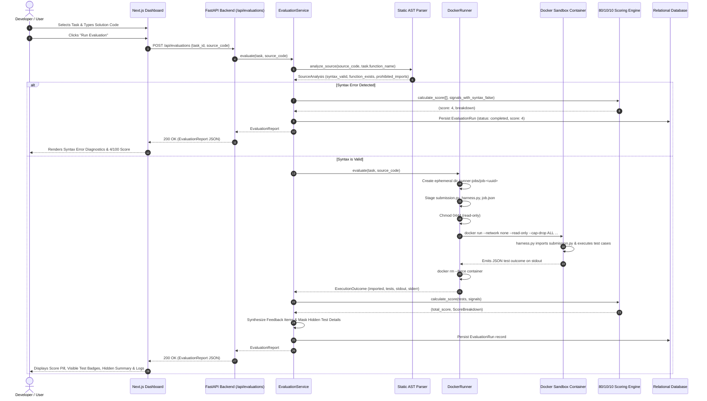

#### Detailed Step-by-Step Breakdown:
1. **User Action**: The developer selects a benchmark task (e.g., `palindrome-normalization`) from the dropdown. The UI fetches task metadata and starter code from `GET /api/tasks/palindrome-normalization`.
2. **Payload Construction**: The developer enters their implementation and clicks "Run Evaluation". The browser client issues an HTTP POST to `/api/evaluations` with body `{"task_id": "palindrome-normalization", "source_code": "..."}`.
3. **Task Resolution**: FastAPI validates inbound body using Pydantic `EvaluationRequest`. Resolves `TaskDefinition` via `task_loader.get("palindrome-normalization")`.
4. **Pre-Execution AST Gatekeeper**: `EvaluationService` passes raw source code to `analyze_source()`. Python's `ast.parse()` parses the code:
   - Validates syntax without importing.
   - Searches AST root for a function definition matching `task.function_name`.
   - Traverses AST nodes via `ast.walk()` to detect prohibited imports (`socket`, `requests`, `urllib`, `ftplib`, `subprocess`, `http`).
5. **Early Exit on Syntax Failure**: If `SyntaxError` is trapped, execution skips container spawning. The scorer awards 4 execution signal points (0 for correctness, 4 for absent prohibited behavior), records the run, and returns immediately.
6. **Container Job Staging**: If syntax is valid, `DockerRunner` generates a unique UUID job workspace under `EVALUATOR_JOB_ROOT`. Stages:
   - `submission.py`: Untrusted participant source code.
   - `harness.py`: Immutable standard-library evaluation harness.
   - `job.json`: Full task test cases (both visible and hidden).
   - Enforces read-only permissions (`chmod 0o444`) on all staged files.
7. **Disposable Sandboxed Execution**: Spawns container `ai-code-evaluator-runner:local` via `subprocess.run()` with `--network none`, `--read-only`, `--cap-drop ALL`, `--security-opt no-new-privileges:true`, `--user 65532:65532`, and memory/CPU caps.
8. **Test Execution**: Inside the container, `harness.py` dynamically imports `submission.py`. Iterates through test cases, measuring execution duration and comparing outputs. Captures stdout/stderr up to 16,000 bytes. Emits structured JSON outcome to stdout.
9. **Teardown & Scoring**: `DockerRunner` kills and removes the container. `EvaluationService` parses stdout JSON into `ExecutionOutcome`. Calls `calculate_score()` to compute points across the 3 dimensions:
   $$	ext{Total Score} = 	ext{Correctness (0-80)} + 	ext{Instruction Adherence (0-10)} + 	ext{Execution Signals (0-10)}$$
10. **Sanitization & Public Response**: Hidden test fixtures are strictly masked into aggregate `passed`/`failed` counts. The full `EvaluationReport` is persisted in the database and returned to the browser for rendering.

---

### Workflow 2: Autonomous Multi-Agent Multi-Iteration Feedback Loop

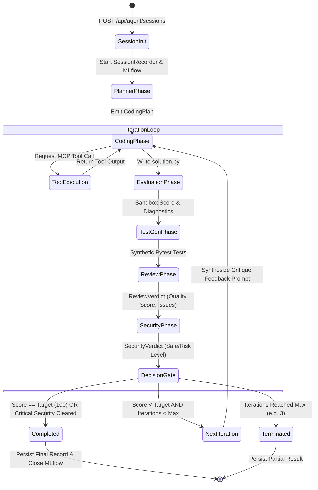

#### Detailed Step-by-Step Breakdown:
1. **Session Kickoff**: User or automated script issues `POST /api/agent/sessions` with `task_id` and optional `max_iterations = 3`. FastAPI launches background task `_run_agent_session` and returns HTTP 202 Accepted with a `session_id`.
2. **Context Binding & Recording**: Orchestrator binds context variables (`task_id`, `session_id`, `run_id`). Initializes `SessionRecorder` (creating `agent_sessions` record in DB) and probes MLflow reachability.
3. **Phase 1: Architecture Planning**:
   - `PlannerAgent` receives task description, function signature, constraints, and examples.
   - Emits structured `CodingPlan`:
     - Algorithmic strategy.
     - Required implementation steps.
     - Identified edge cases (e.g., negative numbers, empty arrays, unicode markers).
     - Complexity estimation (`low`, `medium`, `high`).
4. **Phase 2: Tool-Augmented Code Generation**:
   - `CodingAgent` receives task and plan.
   - Enters an interactive MCP tool-calling loop (bounded by `max_tool_steps = 4` per iteration).
   - Calls `retrieve_task` to review visible test specs.
   - Calls `write_file(path="solution.py", content="...")` to stage implementation.
   - Calls `inspect_ast` to check for syntax validity and forbidden imports.
   - Calls `run_tests` to run an intermediate evaluation in the sandbox.
5. **Phase 3: Formal Sandbox Evaluation**:
   - Orchestrator invokes `EvaluationService.evaluate(task, solution_code)`.
   - Scores the current iteration on the 0–100 scale.
6. **Phase 4: Adversarial Test Generation**:
   - `TestAgent` analyzes generated code and synthesizes additional adversarial unit tests targeting identified boundary conditions.
7. **Phase 5: Code Quality Review**:
   - `ReviewAgent` evaluates code for clean code practices, cyclomatic complexity, and maintainability.
   - Emits `ReviewVerdict` awarding quality score (0–10), issue list with file locations, and concrete fix hints.
8. **Phase 6: Adversarial Security Audit**:
   - `SecurityAgent` audits code for injection vectors, unauthorized syscalls, and sandbox escape attempts.
   - Emits `SecurityVerdict`. If critical vulnerabilities are detected, overrides score to 0 and forces security remediation.
9. **Decision Gate & Reflexion Loop**:
   - If `score >= target_score` (100 points) and code is secure: loop terminates immediately as a triumph.
   - If `score < target_score` and iterations remain: orchestrator bundles the compiler output, test assertion failures, reviewer critique, and security warnings into a comprehensive feedback prompt, feeding it back into the `CodingAgent` for the next iteration.
   - If iteration ceiling is reached: terminates, saving the highest scoring variant.

---

### Workflow 3: Model Context Protocol (MCP) Tool Calling & Workspace Sandboxing

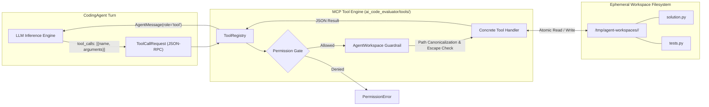

#### Detailed Step-by-Step Breakdown:
1. **Schema Exposing**: During agent turn initialization, `ToolRegistry.get_schemas()` generates OpenAPI-compliant JSON schemas for registered tools (`list_files`, `read_file`, `write_file`, `run_tests`, `inspect_ast`, `retrieve_task`).
2. **Model Tool Invocation**: The LLM emits a completion with `tool_calls` array containing a unique call ID, tool name, and JSON-encoded arguments.
3. **Permission Validation**: `ToolRegistry.execute()` verifies that the tool's required permissions (`READ`, `WRITE`, `EXECUTE`) are present in the `ToolContext.allowed_permissions` set.
4. **Path Canonicalization & Directory Traversal Defense**:
   - Any file operation (`read_file`, `write_file`, `list_files`) resolves paths through `AgentWorkspace._resolve_safe_path()`:
     ```python
     resolved = (workspace_root / requested_path).resolve()
     if not resolved.is_relative_to(workspace_root.resolve()):
         raise PermissionError("Path escape attempt blocked.")
     ```
   - Any attempt to access `/etc/passwd`, `C:\Windows`, or use `..` sequences raises an immediate security exception.
5. **Atomic Workspace Mutations**: `write_file` writes content to a temporary file in the workspace directory and atomically renames it to target destination, preventing partially written files.
6. **Execution Feedback**: Output is wrapped in an `AgentMessage` with `role="tool"` and returned to the agent context for subsequent reasoning turns.

---

### Workflow 4: Secure Isolated Execution in Docker Runner Container

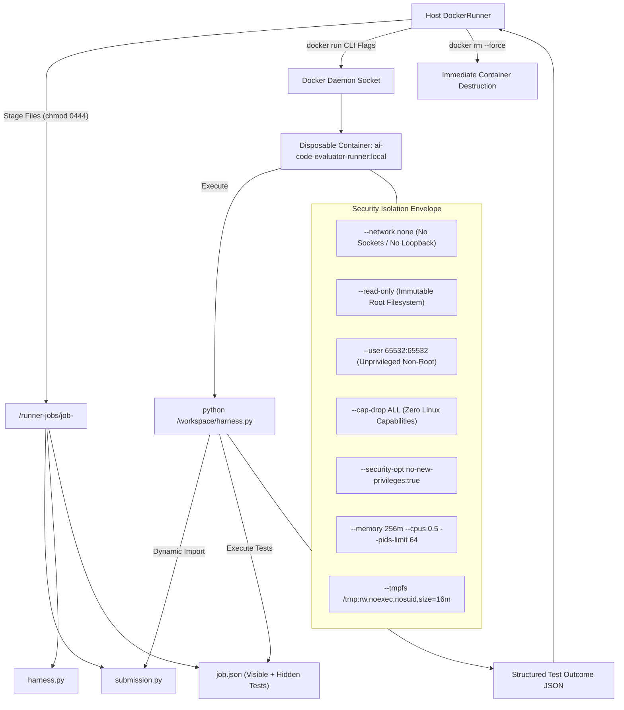

#### Detailed Step-by-Step Breakdown:
1. **Host-Side Volume Preparation**: `DockerRunner` stages code into a dedicated job directory. All files are marked `chmod 0o444` (read-only) so that code executed inside the container cannot modify its own test definitions (`job.json`) or harness (`harness.py`).
2. **Subprocess Invocation**: Spawns Docker via `subprocess.run()` using Python 3.12 without window creation flags on Windows (`subprocess.CREATE_NO_WINDOW`).
3. **Hardened Containment Envelope Applied**:
   - `--network none`: Isolates the network namespace; disables all outbound HTTP, DNS, raw sockets, and Unix domain sockets.
   - `--read-only`: Mounts the entire container root filesystem as read-only.
   - `--cap-drop ALL`: Drops every Linux capability including `CAP_NET_RAW` (packet sniffing), `CAP_SYS_ADMIN` (mounting/cgroups), and `CAP_SYS_PTRACE` (process injection).
   - `--security-opt no-new-privileges:true`: Disallows privilege escalation via `setuid` binaries.
   - `--user 65532:65532`: Runs under numeric distroless user `nobody`.
   - `--tmpfs /tmp:rw,noexec,nosuid,size=16m`: Provides a small RAM-backed temp directory for standard library caches while strictly disabling script execution via `noexec`.
   - `--pids-limit 64`: Restricts process creation, mitigating fork bombs immediately.
4. **Execution & Timeout Watchdog**: Subprocess execution is wrapped in a wall-clock timeout (`task.time_limit_seconds + 3.0s`). If execution exceeds the ceiling, `subprocess.TimeoutExpired` is caught, the container process is terminated, and a `docker rm --force` command is dispatched.
5. **Output Ingestion**: Container outputs a compact JSON string on stdout. The host parser sanitizes host directory paths from the logs before saving.

---

### Workflow 5: Static AST Source Analysis & Instruction Adherence Verification

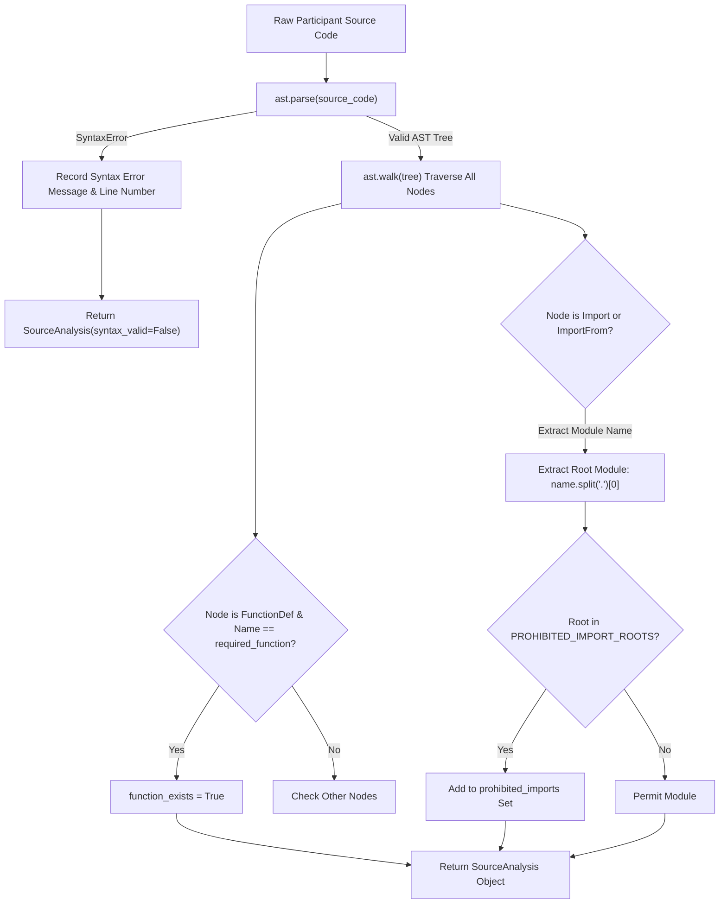

#### Detailed Step-by-Step Breakdown:
1. **Zero-Execution Inspection**: The static analyzer parses code without creating module objects or triggering module-level initialization code.
2. **AST Parsing**: Passes code to `ast.parse(source_code, filename="submission.py")`. If parsing fails, extracts `exc.lineno` and `exc.msg` to provide exact compiler feedback.
3. **Function Signature Validation**: Scans top-level `ast.FunctionDef` and `ast.AsyncFunctionDef` nodes to verify that the required function name specified in `task.json` is declared.
4. **Banned Root Extraction**: Traverses all nodes via `ast.walk()`. For `ast.Import`, extracts each `alias.name`. For `ast.ImportFrom`, extracts `node.module`. Splitting by `.` isolates the root package name.
5. **Prohibited Package Comparison**: Compares root package against `PROHIBITED_IMPORT_ROOTS` (`ftplib`, `http`, `requests`, `socket`, `subprocess`, `urllib`). Flags violations immediately.

---

### Workflow 6: Tri-Partite Mathematical Scoring Pipeline (80/10/10 Rule)

The evaluation engine uses a deterministic, multi-dimensional mathematical formula normalized from **0 to 100 points**:

$$	ext{Total Score} = 	ext{Score}_{	ext{correctness}} + 	ext{Score}_{	ext{adherence}} + 	ext{Score}_{	ext{execution}}$$

```
+----------------------------------------------------------------------------------------+
|                              TOTAL SCORE: 0 - 100 POINTS                                |
+------------------------------------+---------------------------------------------------+
|  1. Unit Test Correctness (80 pts) | round(80 * (Passed Tests / Total Tests))          |
+------------------------------------+---------------------------------------------------+
|  2. Instruction Adherence (10 pts) | Function / Class Signature Exists:         +6 pts |
|                                    | Absence of Prohibited Imports/Behavior:    +4 pts |
+------------------------------------+---------------------------------------------------+
|  3. Execution Signals (10 pts)     | Valid Python Syntax:                       +3 pts |
|                                    | Clean Module Import:                       +3 pts |
|                                    | Executed Within Wall-Clock Timeout:        +2 pts |
|                                    | Zero Fatal Container / Runtime Crashes:    +2 pts |
+------------------------------------+---------------------------------------------------+
```

#### Mathematical Scoring Permutations Table:

| Scenario / Code Condition | Tests Passed (of 8) | Func Exists? | Prohibited Absent? | Syntax Valid? | Import Clean? | Within Time? | Zero Crashes? | Final Score |
|---|---|---|---|---|---|---|---|---|
| **Flawless Solution** | 8 / 8 (80 pts) | Yes (+6) | Yes (+4) | Yes (+3) | Yes (+3) | Yes (+2) | Yes (+2) | **100 / 100** |
| **1 Hidden Edge Case Failed** | 7 / 8 (70 pts) | Yes (+6) | Yes (+4) | Yes (+3) | Yes (+3) | Yes (+2) | Yes (+2) | **90 / 100** |
| **2 Tests Failed** | 6 / 8 (60 pts) | Yes (+6) | Yes (+4) | Yes (+3) | Yes (+3) | Yes (+2) | Yes (+2) | **80 / 100** |
| **Half Tests Passed** | 4 / 8 (40 pts) | Yes (+6) | Yes (+4) | Yes (+3) | Yes (+3) | Yes (+2) | Yes (+2) | **60 / 100** |
| **All Tests Failed (Clean Code)** | 0 / 8 (0 pts) | Yes (+6) | Yes (+4) | Yes (+3) | Yes (+3) | Yes (+2) | Yes (+2) | **20 / 100** |
| **Used Prohibited Library (`requests`)** | 8 / 8 (80 pts) | Yes (+6) | **No (+0)** | Yes (+3) | Yes (+3) | Yes (+2) | Yes (+2) | **96 / 100** |
| **Wrong Function Name (Misspelled)** | 0 / 8 (0 pts) | **No (+0)** | Yes (+4) | Yes (+3) | Yes (+3) | Yes (+2) | Yes (+2) | **14 / 100** |
| **Infinite Loop (Timeout Triggered)**| 0 / 8 (0 pts) | Yes (+6) | Yes (+4) | Yes (+3) | Yes (+3) | **No (+0)** | **No (+0)** | **16 / 100** |
| **Module Import Crash (`ZeroDivisionError`)**| 0 / 8 (0 pts)| Yes (+6) | Yes (+4) | Yes (+3) | **No (+0)** | Yes (+2) | **No (+0)** | **15 / 100** |
| **Syntax Error (Unclosed String)** | 0 / 8 (0 pts) | **No (+0)** | Yes (+4) | **No (+0)** | **No (+0)** | **No (+0)** | **No (+0)** | **4 / 100** |

---

### Workflow 7: MLOps Run Tracking & Experiment Comparison (MLflow + PostgreSQL)

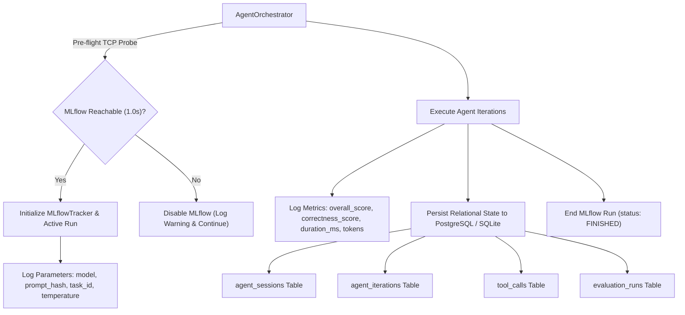

#### Detailed Step-by-Step Breakdown:
1. **Socket Pre-Flight Reachability Probe**: The `MLflowTracker` performs a 1.0-second TCP socket test to the configured host. If MLflow is unreachable or disabled via `MLFLOW_DISABLED=1`, tracking gracefully degrades to a no-op, preventing network timeouts from freezing the orchestrator.
2. **Experiment & Run Provisioning**: If reachable, ensures the named experiment exists and calls `mlflow.start_run()`.
3. **Parameter Logging**: Logs model snapshot (`gpt-4o-2024-08-06`), temperature (`0.0`), task ID, and git commit hash.
4. **Metric Logging**: Across each iteration, logs numeric metrics: total score, correctness points, instruction adherence points, execution signal points, prompt tokens, completion tokens, and latency.
5. **Relational Persistence**: Simultaneously, `SessionRecorder` writes relational records into `agent_sessions`, `agent_iterations`, and `tool_calls` via SQLAlchemy async sessions, enabling the Next.js dashboard to inspect real-time progress.

---

### Workflow 8: Offline Fixture Replay & CI/CD Regression Testing

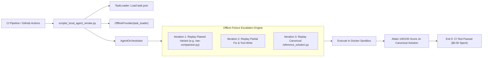

#### Detailed Step-by-Step Breakdown:
1. **Zero Cost Invariant**: To validate the entire platform in CI/CD without incurring OpenAI API costs or requiring secret API keys, the test suite injects `OfflineProvider`.
2. **Fixture Identification**: `OfflineProvider` inspects the active task prompt and locates pre-existing solution fixtures in `benchmarks/python/<task-id>/`.
3. **Escalation Replay**:
   - In iteration 1, it emits code from `incorrect_solutions/` (e.g., `raw-comparison.py`), generating a realistic partial failure.
   - It simulates tool calling by writing files to the workspace.
   - In final iterations, it retrieves and writes the canonical `reference_solution.py`.
4. **Sandbox Validation**: The Docker sandbox and scoring engine evaluate these fixtures normally, verifying that sandbox containment, error reporting, scoring formulas, and DB logging function perfectly under production conditions.

---

### Workflow 9: API Contract Synchronization & TypeScript Code Generation

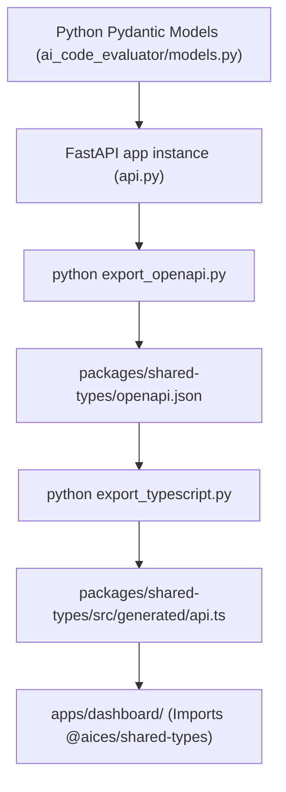

#### Detailed Step-by-Step Breakdown:
1. **Single Source of Truth**: Developers modify or extend Pydantic models in `services/evaluator/src/ai_code_evaluator/models.py`.
2. **OpenAPI Schema Generation**: `npm run contracts:export` invokes `export_openapi.py`. It inspects the FastAPI `app` and exports the canonical OpenAPI v3 specification to `packages/shared-types/openapi.json`.
3. **TypeScript Generation**: `npm run contracts:generate` executes `export_typescript.py`. It parses the JSON schema components and translates them into strongly typed TypeScript interfaces in `packages/shared-types/src/generated/api.ts`.
4. **Frontend Consumption**: The Next.js dashboard directly imports these types, ensuring compile-time type safety across network boundaries.

---

### Workflow 10: Database Migration & Schema Evolution (Alembic)

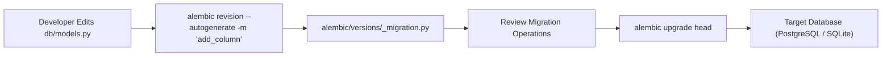

#### Detailed Step-by-Step Breakdown:
1. **Model Modification**: Developer adds or updates models in `ai_code_evaluator/db/models.py` using standard SQLAlchemy declarative syntax.
2. **Revision Generation**: Developer executes `alembic revision --autogenerate -m "description"`.
3. **Metadata Diffing**: Alembic inspects `target_metadata = Base.metadata` in `alembic/env.py` and compares it against the active database schema, generating migration operations (`op.create_table`, `op.add_column`).
4. **Application**: Executing `alembic upgrade head` applies the schema migrations inside transactions, updating the `alembic_version` tracking table.

---

### Workflow 11: Benchmark Comparative Analysis (`run_baseline` vs `run_agent`)

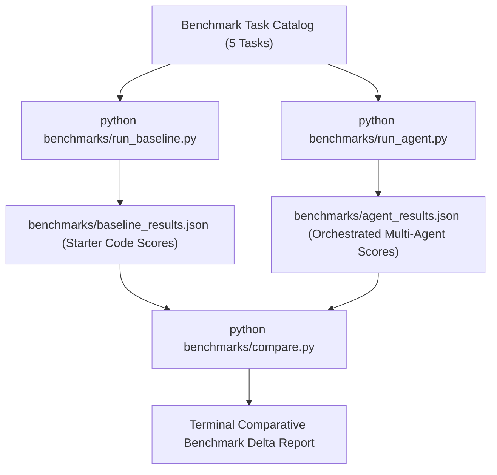

#### Detailed Step-by-Step Breakdown:
1. **Baseline Evaluation**: `run_baseline.py` evaluates starter code across all tasks to establish the lower bound of code performance (typically 20/100 points for syntax and imports). Saves to `baseline_results.json`.
2. **Multi-Agent Evaluation**: `run_agent.py` executes the 5-agent orchestrator across all tasks. Agents formulate plans, call tools, review code, and remediate errors. Saves to `agent_results.json`.
3. **Comparison Reporting**: `compare.py` reads both result files, correlates tasks by ID, calculates per-task score improvements ($\Delta = 	ext{Score}_{	ext{agent}} - 	ext{Score}_{	ext{baseline}}$), and prints a formatted terminal summary showing overall algorithmic capability gains.

---

## 5. Exhaustive Feature Expansion Blueprint (What All Else Can We Add)

This section details the concrete, production-grade engineering roadmap for expanding CodeBench. It outlines both high-level architectural capabilities and a file-by-file specification of exact features, classes, methods, and enhancements to add to every component in the codebase.

---

### 5.1 System-Level Capabilities & Next-Generation Architectural Expansions

```
+-----------------------------------------------------------------------------------------------+
|                           NEXT-GENERATION PLATFORM ARCHITECTURE                               |
+-----------------------------------------------------------------------------------------------+
|  1. Hardware-Level MicroVM Isolation: AWS Firecracker / Kata Containers / gVisor (runsc)       |
|  2. Polyglot Multi-Language Evaluation Engine: TypeScript, Go, Rust, C++, Java via Tree-sitter|
|  3. Dynamic Directed Acyclic Graph (DAG) Agent Mesh with Autonomous Reflexion Branching       |
|  4. Mutation Testing Framework: Assessing Test Suite Quality via Synthesized Code Mutants     |
|  5. Distributed Execution Fleet: Celery / Temporal Worker Queues with Redis Task Broker       |
|  6. Real-Time Streaming Telemetry: Bidirectional WebSockets with xterm.js Terminal Emulation  |
|  7. Enterprise Security: Multi-Tenancy, OAuth2 / OIDC, RBAC, API Key Quotas, Audit Trails     |
|  8. LLM Gateway & Semantic Caching: LiteLLM proxy, Redis vector cache, and Token Budgeting   |
+-----------------------------------------------------------------------------------------------+
```

1. **Hardware-Level MicroVM Virtualization (AWS Firecracker / gVisor)**:
   - *Current Limitation*: Standard Docker containers share the host Linux kernel. A kernel vulnerability (e.g., zero-day dirty pipe or container escape) poses a threat to the host system.
   - *Architecture Expansion*: Replace standard Docker runtime with **AWS Firecracker microVMs** or **gVisor (`runsc`)**. Firecracker boots minimalist virtual machines with independent Linux kernels in sub-100ms, providing true hardware-level isolation with zero kernel sharing.
2. **Polyglot Multi-Language Evaluation Engine**:
   - *Current Limitation*: Currently restricted to Python 3.12.
   - *Architecture Expansion*: Introduce unified language runtime harnesses for **TypeScript (Node/Bun)**, **Go 1.23**, **Rust 1.80**, and **C++20**. Utilize **Tree-sitter** for universal abstract syntax tree (AST) parsing and prohibited import inspection across all languages.
3. **Dynamic Directed Acyclic Graph (DAG) Multi-Agent Mesh**:
   - *Current Limitation*: The current orchestrator executes a linear sequential pipeline (Planner -> Coder -> Test -> Review -> Security).
   - *Architecture Expansion*: Implement an autonomous state-graph orchestrator (inspired by LangGraph). Allows conditional branching (e.g., if SecurityAgent detects a high-risk finding, route immediately to SecurityRemediatorAgent; if TestAgent fails to generate tests, route to MockGeneratorAgent). Supports parallel multi-candidate generation (Tree of Thoughts) with competitive tournament scoring.
4. **Mutation Testing Engine for Generated Tests**:
   - *Current Limitation*: `TestAgent` synthesizes unit tests, but test quality is not independently scored.
   - *Architecture Expansion*: Integrate a mutation testing engine (such as `mutmut` or custom AST mutant generation). Injects synthetic bugs (e.g., inverting comparison operators `<` to `>=`, replacing constants) into candidate solutions to verify whether the `TestAgent`'s unit tests detect the mutations (Mutation Score metric).
5. **Distributed Asynchronous Worker Fleet**:
   - *Current Limitation*: Evaluator executes Docker CLI subprocesses directly on the API server instance.
   - *Architecture Expansion*: Decouple API ingestion from evaluation execution using **Temporal** or **Celery** with **Redis** / **RabbitMQ**. Enables horizontal autoscaling of worker nodes running across dedicated Kubernetes runner pods, scaling to thousands of concurrent evaluations.
6. **Real-Time Streaming Telemetry & Terminal Replay**:
   - *Current Limitation*: Sessions poll every 3 seconds; stdout is only available post-execution.
   - *Architecture Expansion*: Deploy WebSocket and Server-Sent Events (SSE) streaming. Embed `xterm.js` in the dashboard to stream real-time compiler stdout/stderr, pytest progress bars, and live agent thinking traces token-by-token.
7. **Enterprise Multi-Tenancy & Access Control**:
   - *Current Limitation*: Single-tenant platform with open endpoints.
   - *Architecture Expansion*: Implement organization-level multi-tenancy, OAuth2/OIDC integration (GitHub, Google, Okta), fine-grained Role-Based Access Control (Admin, Benchmarker, Viewer), cryptographic API key issuance with rate-limiting buckets (token-bucket algorithm), and immutable audit logs.
8. **LLM Gateway, Semantic Caching & Token Cost Optimization**:
   - *Current Limitation*: Direct calls to OpenAI SDK.
   - *Architecture Expansion*: Route model inference through an LLM gateway (LiteLLM / vLLM) supporting multiple providers (Anthropic Claude 3.5 Sonnet, Google Gemini 1.5 Pro, Meta Llama 3.3). Integrate semantic caching via Redis vector search to avoid re-generating identical prompts, reducing benchmark evaluation costs by up to 60%.

---

### 5.2 File-by-File & Component-by-Component New Feature Proposals

Here is the exact blueprint of new capabilities, classes, and methods to implement across every single file in the repository:

#### 1. `services/evaluator/src/ai_code_evaluator/models.py`
- **Feature 1: Multi-File Submission Contract (`MultiFileSubmission`)**: Extend beyond single-file strings to accept project trees: `files: dict[str, str]` allowing models to write modular code across multiple modules (`models.py`, `utils.py`, `main.py`).
- **Feature 2: AST Complexity Constraints Schema (`ComplexityConstraints`)**: Add fields to `TaskDefinition`: `max_cyclomatic_complexity: int`, `max_nested_depth: int`, `required_algorithmic_time_complexity: Literal["O(1)", "O(N)", "O(N log N)"]`.
- **Feature 3: Token & Cost Budget Enforcement Schema (`BudgetSpec`)**: Add budget constraints to `AgentConfig`: `max_prompt_tokens: int`, `max_completion_tokens: int`, `max_cost_usd: float`.
- **Feature 4: Dynamic Matrix Testing Schema (`MatrixTestCase`)**: Support parameterized test matrix generation with combinatorial input dimensions and timeout overrides.

#### 2. `services/evaluator/src/ai_code_evaluator/api.py`
- **Feature 1: WebSocket Live Execution Streaming Endpoint (`/ws/agent/sessions/{session_id}`)**: Bidirectional WebSocket connection broadcasting token-by-token agent reasoning, tool call requests, and live container stdout lines.
- **Feature 2: Dynamic Task Creation & Ingestion API (`POST /api/tasks`)**: Allow authenticated administrators to upload new benchmark tasks via JSON or ZIP packages containing test suites and reference solutions.
- **Feature 3: API Key Authentication & Rate Limiting Middleware (`ApiKeyMiddleware`)**: Enforce `X-API-Key` headers with tiered rate-limiting quotas (e.g., 50 evaluations/hour) stored in Redis.
- **Feature 4: Bulk Batch Benchmark Evaluation (`POST /api/benchmarks/run`)**: Trigger evaluation runs across all tasks in parallel with configurable concurrency limits (`concurrency = 5`).

#### 3. `services/evaluator/src/ai_code_evaluator/orchestrator.py`
- **Feature 1: Multi-Candidate Tournament Selection (Tree of Thoughts)**: In each iteration, prompt the `CodingAgent` to generate $K = 3$ diverse algorithmic candidate implementations in parallel, evaluate each in isolated sandboxes, and advance the highest scoring candidate to the review phase.
- **Feature 2: Human-in-the-Loop Interactivity Checkpoints (`pause_for_human_guidance`)**: Provide hook allowing human engineers to review agent plans or code before container execution, injecting custom advice or approving security exceptions.
- **Feature 3: Token Budgeting & Dynamic Early Stopping Guardrails**: Monitor cumulative token usage across iterations. If an agent enters repetitive tool loops without score improvement, trigger early termination to conserve API costs.
- **Feature 4: Autonomous Self-Healing Patch Synthesis**: When `ReviewAgent` flags a specific issue with a line number, prompt a targeted `PatchAgent` to emit unified diffs (`git diff`) rather than rewriting the entire source file.

#### 4. `services/evaluator/src/ai_code_evaluator/runner.py`
- **Feature 1: Warm Container Pooling (`RunnerContainerPool`)**: Maintain a pre-spawned pool of warm runner containers. Eliminates the ~250ms Docker container cold-start startup overhead, accelerating evaluations by 4x.
- **Feature 2: gVisor / Kata Container Runtime Driver**: Add configuration option `EVALUATOR_CONTAINER_RUNTIME=runsc` to launch containers under gVisor kernel sandboxing.
- **Feature 3: Real-Time Stdout/Stderr Pipe Streaming**: Replace synchronous `subprocess.run` with `asyncio.create_subprocess_exec` streaming stdout chunks through async generators directly to WebSockets.
- **Feature 4: Automated Memory Profiling & Resource Accounting**: Monitor container cgroup stats (`memory.max_usage_in_bytes`, `cpuacct.usage`) to capture peak memory footprints and precise CPU millicores consumed.

#### 5. `services/evaluator/src/ai_code_evaluator/scoring.py`
- **Feature 1: Non-Linear Algorithmic Complexity Scoring**: Measure execution runtime across escalating input sizes ($N = 10, 100, 1000, 10000$) to fit empirical curves and penalize $O(N^2)$ implementations on tasks requiring $O(N)$.
- **Feature 2: Code Elegance & PEP 8 Static Deductions**: Subtract up to 5 points for severe style violations, naming convention breaches, or excessive cyclomatic complexity ($M > 10$).
- **Feature 3: Mutation Score Weighting**: Incorporate mutation testing pass rates into the correctness score: award bonus points if the solution passes tests while also killing injected mutants.
- **Feature 4: Memory Efficiency Factor**: Reward solutions that execute within minimum memory thresholds ($< 32$ MB) with performance badges and bonus points.

#### 6. `services/evaluator/src/ai_code_evaluator/analysis.py`
- **Feature 1: Universal Tree-sitter Multi-Language Parser**: Replace standard library `ast` with Tree-sitter bindings, enabling universal syntax analysis for Python, TypeScript, Go, and Rust.
- **Feature 2: Static Security Vulnerability Scanner (Bandit Rule Integration)**: Detect insecure cryptographic algorithms (`hashlib.md5`), hardcoded secrets/tokens, and SQL injection strings directly in AST nodes.
- **Feature 3: Cyclomatic Complexity Calculator (`CyclomaticVisitor`)**: Traverse AST branching nodes (`If`, `While`, `For`, `ExceptHandler`, `BoolOp`) to compute McCabe cyclomatic complexity and maximum nesting depth.
- **Feature 4: Anti-Pattern & Hallucination Detector**: Detect common LLM hallucinations, such as referencing non-existent standard library methods or inventing fake third-party modules.

#### 7. `services/evaluator/src/ai_code_evaluator/server.py`
- **Feature 1: Server-Sent Events (SSE) Transport Protocol**: Add SSE transport alongside standard JSON-RPC, enabling browser clients and Claude Desktop to connect via lightweight streaming HTTP.
- **Feature 2: Interactive Debugging Tool (`inspect_variable`)**: Expose an MCP tool allowing agents to set breakpoints and inspect local variables inside sandboxed executions.
- **Feature 3: Task Catalog Search & Filter Tool (`search_tasks`)**: Enable agents to query the benchmark catalog by difficulty, category, or required dependencies.

#### 8. `services/evaluator/src/ai_code_evaluator/service.py`
- **Feature 1: Distributed Job Caching**: Hash task ID + normalized source code (SHA-256) to cache evaluation reports in Redis, avoiding duplicate container executions for identical code.
- **Feature 2: Asynchronous Non-Blocking Execution Worker**: Shift synchronous evaluation calls to threadpools or async worker tasks to prevent blocking the event loop.
- **Feature 3: Automated Remediation Hint Generator**: Map execution error messages and failed assertions to specific educational hints and documentation links.

#### 9. `services/evaluator/src/ai_code_evaluator/tasks.py`
- **Feature 1: Remote Task Synchronization (S3 / Git Catalog Sync)**: Sync benchmark tasks dynamically from a remote GitHub repository or S3 bucket without requiring service redeployment.
- **Feature 2: Dynamic Synthetic Test Case Generator**: Generate randomized hidden test cases on the fly using property-based testing schemas (Hypothesis-style), rendering memorization impossible.
- **Feature 3: Task Versioning & Deprecation Tagging**: Support multiple revisions of benchmark tasks with semantic versioning (`palindrome-normalization@v2.1`).

#### 10. `services/evaluator/src/ai_code_evaluator/errors.py`
- **Feature 1: Granular Security Breach Exceptions (`SandboxEscapeAttemptError`, `ProhibitedSyscallError`)**: Categorize security events for immediate SOC alerting.
- **Feature 2: Resource Exhaustion Exceptions (`OutOfMemoryError`, `CPUTimeoutError`, `PidLimitExceededError`)**: Distinguish between algorithmic infinite loops and kernel OOM terminations.
- **Feature 3: Diagnostic Serialization Helpers**: Add `.to_diagnostic_dict()` methods on all errors to emit structured debugging payloads for UI rendering.

#### 11. `services/evaluator/src/ai_code_evaluator/logging.py`
- **Feature 1: OpenTelemetry (OTel) Tracing Integration**: Export distributed traces to OpenTelemetry collectors (Jaeger, Datadog), correlating agent turns, LLM calls, and Docker execution spans.
- **Feature 2: Structured JSON Log Formatter**: Output logs in machine-readable JSON format for ingestion into Elasticsearch, Splunk, or AWS CloudWatch.
- **Feature 3: Audit Trail Encryption**: Encrypt sensitive log records containing participant source code or proprietary API keys.

#### 12. `services/evaluator/src/ai_code_evaluator/agents/planner.py`
- **Feature 1: Few-Shot Architectural Exemplar Injection**: Dynamically inject few-shot examples of high-scoring architecture plans matching the task category.
- **Feature 2: Big-O Algorithmic Target Proofs**: Require the planner to output formal time/space complexity proofs before approving the approach.
- **Feature 3: Multi-Strategy Decomposition**: Output primary strategy along with an alternative fallback strategy in case the primary approach encounters edge-case failures.

#### 13. `services/evaluator/src/ai_code_evaluator/agents/coder.py`
- **Feature 1: Scratchpad Chain-of-Thought Logging**: Maintain an internal reasoning scratchpad where the agent documents invariant checks before emitting code blocks.
- **Feature 2: Incremental File Patching**: Utilize unified diffs (`patch_file`) rather than rewriting full source files on large codebases.
- **Feature 3: Type Annotation Enforcement**: Prompt coder to generate strict, 100% type-annotated code passing `mypy --strict` checks.

#### 14. `services/evaluator/src/ai_code_evaluator/agents/reviewer.py`
- **Feature 1: Automated AST Linter Integration**: Augment LLM review with automated outputs from Ruff, Flake8, and Radon metrics.
- **Feature 2: Maintainability Index Calculation**: Compute standard maintainability index ($0 - 100$) combining Halstead volume, cyclomatic complexity, and line counts.
- **Feature 3: Actionable Code Rewrite Suggestions**: Include ready-to-apply code snippets for every flagged issue.

#### 15. `services/evaluator/src/ai_code_evaluator/agents/security_agent.py`
- **Feature 1: Common Weakness Enumeration (CWE) Tagging**: Map every security finding to standardized CWE identifiers (e.g., CWE-78 for OS Command Injection, CWE-400 for Resource Exhaustion).
- **Feature 2: Taint Analysis Tracker**: Track untrusted user inputs through variable assignments to sensitive sinks.
- **Feature 3: Automated Exploit Verification**: Synthesize a targeted unit test to confirm whether a flagged vulnerability is exploitable before failing the run.

#### 16. `services/evaluator/src/ai_code_evaluator/agents/test_agent.py`
- **Feature 1: Property-Based Test Synthesis**: Generate tests using the `hypothesis` library, testing invariant properties across thousands of randomized inputs.
- **Feature 2: Boundary Condition Coverage Matrix**: Automatically identify edge conditions (null, zero, max integer, empty collection, Unicode surrogates) and assert coverage for each.
- **Feature 3: Regression Test Assertion Generation**: Analyze previous iteration failure traces and generate targeted regression tests to prevent recidivism.

#### 17. `services/evaluator/src/ai_code_evaluator/agents/base.py`
- **Feature 1: Token Usage Accumulator & Budget Watchdog**: Maintain session-wide token totals and raise `BudgetExceededError` when thresholds are crossed.
- **Feature 2: Multi-Model Fallback Routing**: If primary model (`gpt-4o`) fails with 429/503 errors, automatically failover to secondary provider (`claude-3-5-sonnet` or `gemini-1.5-pro`).
- **Feature 3: Telemetry Span Decorators**: Wrap agent turns in OpenTelemetry spans to track TTFT (Time to First Token) and total latency.

#### 18. `services/evaluator/src/ai_code_evaluator/agents/models.py`
- **Feature 1: Token Cost Accounting Fields**: Add `estimated_cost_usd` to `AgentResponse` based on model-specific prompt/completion token pricing.
- **Feature 2: Agent Thought & Reflection Fields**: Explicitly model `thinking_process: str` separate from code content to support reasoning models (o1, o3-mini).
- **Feature 3: Quality Metric Distributions**: Add detailed metric breakdown fields to `ReviewVerdict` (readability, modularity, efficiency, documentation).

#### 19. `services/evaluator/src/ai_code_evaluator/db/database.py`
- **Feature 1: Read/Write Connection Splitting**: Configure primary database write engine alongside pooled read replicas for dashboard queries.
- **Feature 2: Connection Pool Health Telemetry**: Expose connection pool metrics (active, overflow, idle connections) to Prometheus `/metrics` endpoints.
- **Feature 3: Automatic Database Reconnection**: Implement resilient reconnect loops with exponential backoff on transient network disconnects.

#### 20. `services/evaluator/src/ai_code_evaluator/db/models.py`
- **Feature 1: Organization & Multi-Tenancy Columns**: Add `organization_id` foreign keys to `Experiment`, `EvaluationRun`, and `AgentSession` tables.
- **Feature 2: Soft Deletion (`deleted_at`)**: Add soft-delete capabilities across evaluation runs to preserve audit trails while allowing user archiving.
- **Feature 3: Vector Embeddings for Task Similarity**: Add `embedding: Vector(1536)` column to `Task` table to support semantic search and recommendation of related benchmark challenges.

#### 21. `services/evaluator/src/ai_code_evaluator/db/crud.py`
- **Feature 1: Cursor-Based Pagination**: Replace offset/limit pagination with keyset (cursor-based) pagination for high-performance querying on tables with $> 100,000$ rows.
- **Feature 2: Bulk Metric Aggregation Queries**: Add optimized SQL analytical queries computing rolling average scores, pass rates, and model benchmark rankings.
- **Feature 3: Full-Text Search Queries**: Add full-text search across task instructions, agent traces, and code submissions using PostgreSQL `tsvector`.

#### 22. `services/evaluator/src/ai_code_evaluator/mlops/mlflow_tracker.py`
- **Feature 1: Code Diff & Solution Artifact Upload**: Log full source code diffs between iterations directly into MLflow artifact storage.
- **Feature 2: Model Performance Comparison Tagging**: Tag runs with Git commit SHAs, prompt template version hashes, and sandbox image digests for regression tracking.
- **Feature 3: Automated Slack/Discord Webhook Notifications**: Dispatch automated alert notifications when benchmark regressions exceed a configurable threshold ($> 5\%$).

#### 23. `services/evaluator/src/ai_code_evaluator/providers/base.py`
- **Feature 1: Streaming API Interface (`generate_stream`)**: Abstract async generator interface emitting text chunks and partial tool calls in real time.
- **Feature 2: Multimodal Input Support**: Support image inputs (diagrams, architecture charts) for visual coding tasks.
- **Feature 3: Batch Inference Dispatch**: Support batch API submission for non-urgent bulk evaluations at 50% reduced cost.

#### 24. `services/evaluator/src/ai_code_evaluator/providers/offline.py`
- **Feature 1: Dynamic Synthetic Flaw Injector**: Randomly mutate reference solutions (e.g., delete a boundary check or inject a typo) to simulate novel agent flaws offline.
- **Feature 2: Latency Simulation**: Add configurable artificial delay (`simulate_latency_ms = 500`) to test frontend loading states and async polling behavior realistically.
- **Feature 3: Recorded Trace Playback**: Load and replay exact historical production traces recorded from live OpenAI sessions.

#### 25. `services/evaluator/src/ai_code_evaluator/providers/openai_provider.py`
- **Feature 1: Prompt Caching Header Utilization**: Leverage OpenAI prompt caching headers (`prompt_cache_key`) to reduce input token billing on repetitive agent system prompts.
- **Feature 2: Reasoning Effort Parameter Support**: Expose `reasoning_effort: Literal["low", "medium", "high"]` for OpenAI o1 and o3-mini models.
- **Feature 3: Automatic Tier Rate-Limit Throttling**: Track tokens per minute (TPM) and requests per minute (RPM) against OpenAI Tier limits, throttling calls proactively before hitting 429s.

#### 26. `services/evaluator/src/ai_code_evaluator/runtime/harness.py`
- **Feature 1: High-Resolution Memory Tracing**: Use `tracemalloc` to capture peak memory allocation during test execution with byte precision.
- **Feature 2: Syscall Auditing via Seccomp**: Apply custom in-process seccomp filters restricting disallowed syscalls (`fork`, `socket`, `execve`).
- **Feature 3: Concurrent Test Execution**: Execute independent test cases in parallel using `concurrent.futures.ThreadPoolExecutor` inside the container for 3x faster runtimes.
- **Feature 4: Granular Assertion Difference Highlighting**: Use standard library `difflib.ndiff` to produce visual character-level diffs on failed string or collection comparisons.

#### 27. `services/evaluator/src/ai_code_evaluator/tools/registry.py`
- **Feature 1: Dynamic Tool Permission Escalation**: Support elevation requests where an agent must provide a justification prompt before accessing write or execution privileges.
- **Feature 2: Tool Execution Telemetry**: Record execution duration, memory overhead, and parameter sizes for every tool call.
- **Feature 3: Strict JSON Schema Validation**: Validate inbound tool call arguments against registered Pydantic schemas before handler execution.

#### 28. `services/evaluator/src/ai_code_evaluator/tools/sandbox.py`
- **Feature 1: Symlink Poisoning Protection**: Evaluate all symlinks with `os.path.realpath` to prevent symlink race conditions (`TOCTOU`) and directory escapes.
- **Feature 2: Quota-Bounded Storage Caps**: Enforce strict disk storage limits (e.g., max 50 MB) inside `/tmp/agent-workspaces/<session_id>`.
- **Feature 3: Ephemeral Auto-Cleanup**: Automatically purge workspace directories using background timers after session completion.

#### 29. `services/evaluator/src/ai_code_evaluator/tools/definitions.py`
- **Feature 1: `git_diff()` Tool**: Allow the agent to view unified diffs of workspace changes between iterations.
- **Feature 2: `run_linter()` Tool**: Expose a tool that runs Ruff or Flake8 on the workspace and returns structured linting warnings.
- **Feature 3: `benchmark_performance()` Tool**: Provide micro-benchmarking tool measuring average runtime over 1,000 iterations for performance optimization.
- **Feature 4: `view_call_graph()` Tool**: Generate and return an ASCII call graph of defined functions and dependencies.

#### 30. `apps/dashboard/app/page.tsx`
- **Feature 1: Monaco Code Editor Integration**: Replace basic textarea with full **Monaco Editor** (VS Code engine) featuring Python syntax highlighting, line numbers, autocomplete, and error squigglies.
- **Feature 2: Split-View Side-by-Side Diff Inspector**: Allow users to compare their submission against the canonical reference solution side-by-side with color-coded diff blocks.
- **Feature 3: Keyboard Shortcuts (`Ctrl+Enter` to Run)**: Bind standard developer hotkeys to trigger evaluations instantly without clicking buttons.

#### 31. `apps/dashboard/app/sessions/page.tsx`
- **Feature 1: Live Status Filter & Search Bar**: Filter sessions by status (`completed`, `in_progress`, `failed`), task name, or score range ($> 90$).
- **Feature 2: Real-Time SSE / WebSocket Listener**: Replace 3-second polling with instant WebSocket events when sessions update.
- **Feature 3: Bulk Run Comparison Selector**: Allow selecting multiple sessions with checkboxes to generate a comparative analysis overlay.

#### 32. `apps/dashboard/app/sessions/[id]/page.tsx`
- **Feature 1: Interactive Agent Reasoning Replay**: Step-by-step playback slider showing how the code evolved across iterations, highlighting tool calls, compiler errors, and review fixes.
- **Feature 2: Embedded xterm.js Terminal**: Live terminal tab displaying exact container stdout/stderr output with ANSI color codes.
- **Feature 3: Export Session Report (PDF / Markdown)**: Download comprehensive session report including code, scores, and review findings for compliance or portfolio sharing.

#### 33. `apps/dashboard/app/experiments/page.tsx`
- **Feature 1: Interactive Score Distribution Chart**: Render interactive scatter plots and bar charts (using Recharts or Chart.js) comparing model accuracy, latency, and token costs.
- **Feature 2: Regression Alert Badges**: Flag benchmark runs that show statistically significant score drops compared to earlier commits.
- **Feature 3: Direct MLflow Deep-Linking**: Provide direct clickable URLs navigating to the exact run in the external MLflow UI.

#### 34. `apps/dashboard/components/evaluation-workspace.tsx`
- **Feature 1: Tabbed Interface for Output Views**: Organize test results into dedicated tabs: "Visible Tests", "Hidden Summary", "Raw Terminal Logs", "AST Diagnostics".
- **Feature 2: Resizable Split Panes**: Allow users to drag the separator between the editor and output pane for customizable layout widths.
- **Feature 3: Copy-to-Clipboard & Download Action**: One-click button to copy generated code, reports, or test results.
- **Feature 4: Dark/Light Theme Toggle**: Seamless toggle between sleek dark mode and high-contrast light theme.

#### 35. `apps/dashboard/components/site-chrome.tsx`
- **Feature 1: Live Service Health Modal**: Clicking the runner status indicator opens a modal displaying Docker daemon status, runner image tags, and database latency.
- **Feature 2: Global Search Command Palette (`Cmd+K`)**: Rapidly search tasks, sessions, and documentation from anywhere in the application.
- **Feature 3: User Profile & API Key Management**: Dropdown managing user session, organization, and API tokens.

#### 36. `apps/dashboard/components/status-pill.tsx`
- **Feature 1: Animated Pulse Indicators**: Add subtle CSS pulse animations for active (`running`, `in_progress`) states.
- **Feature 2: Interactive Tooltips**: Hovering over a status pill displays detailed sub-status metrics (e.g., "Failed on test 3/8: AssertionError").

#### 37. `apps/dashboard/lib/api.ts`
- **Feature 1: Exponential Backoff Retry Client**: Wrap failed network requests in retry logic with jitter to handle intermittent service restarts.
- **Feature 2: AbortController Integration**: Support request cancellation when navigating away from pages or clicking "Cancel Run".
- **Feature 3: Client-Side Response Caching**: Cache task definitions in `localStorage` or memory to reduce redundant backend roundtrips.

#### 38. `apps/dashboard/lib/format.ts`
- **Feature 1: Relative Time Formatter ("2 minutes ago")**: Format timestamps using `Intl.RelativeTimeFormat`.
- **Feature 2: Human-Readable Byte Formatter**: Format memory and buffer sizes (`14.2 KB`, `256 MB`).
- **Feature 3: Currency Cost Formatter**: Format model costs to fractions of a cent (`$0.0042`).

#### 39. `packages/shared-types/`
- **Feature 1: Runtime Schema Validation with Zod**: Complement static TypeScript interfaces with Zod schemas for runtime validation in the browser.
- **Feature 2: Auto-Generated Python / TypeScript SDK Clients**: Publish client libraries with full typed autocomplete for external developers.
- **Feature 3: JSON Schema Export Script**: Export standard JSON Schema files alongside OpenAPI specs.

#### 40. `benchmarks/` (`run_agent.py`, `run_baseline.py`, `compare.py`)
- **Feature 1: Concurrency Pool (`asyncio.Semaphore(5)`)**: Execute benchmark tasks in parallel across 5 concurrent workers, slashing full benchmark runtime from 60s to 12s.
- **Feature 2: Markdown & HTML Comparison Report Generation**: Output formatted Markdown tables and static HTML reports suitable for GitHub PR comments.
- **Feature 3: Statistical Significance Calculation (p-value)**: Compute paired t-tests or Wilcoxon signed-rank tests across multiple benchmark runs to verify whether improvements are statistically significant.

#### 41. `docker/runner/Dockerfile`
- **Feature 1: Multi-Architecture Build Support (`linux/amd64`, `linux/arm64`)**: Build cross-platform images supporting Apple Silicon and Linux servers seamlessly.
- **Feature 2: Distroless Base Image**: Migrate to Google Distroless Python image (`gcr.io/distroless/python3-debian12`), completely removing shell binaries (`/bin/sh`, `/bin/bash`) for zero attack surface.
- **Feature 3: Pre-Installed Scientific Libraries**: Provide secondary runner variant pre-packaged with `numpy`, `scipy`, and `sympy` for mathematical coding benchmarks.

#### 42. `docker-compose.yml`
- **Feature 1: Redis Caching Service**: Add Redis 7 container for task caching, token rate-limiting, and WebSocket pub/sub.
- **Feature 2: Prometheus & Grafana Monitoring**: Add Prometheus and Grafana containers pre-configured with dashboards tracking evaluation latency, container count, and error rates.
- **Feature 3: Production Caddy / Nginx Reverse Proxy**: Add HTTPS reverse proxy container with automatic SSL certificate issuance.

#### 43. `scripts/`
- **Feature 1: Automated Load & Stress Testing Script (`scripts/load_test.py`)**: Simulate 100 concurrent evaluation requests using `locust` or `httpx` to measure system throughput and container queue behavior.
- **Feature 2: Synthetic Task Generator (`scripts/generate_task.py`)**: Use LLMs to generate novel benchmark tasks, complete with hidden tests, reference solutions, and failure taxonomies.
- **Feature 3: Docker Security Compliance Auditor (`scripts/audit_docker_security.py`)**: Automated verification script asserting that no container can access the network, escalate privileges, or write outside `/tmp`.

---

## 6. Senior & Staff AI Systems Engineering Interview Guide

This section equips software engineers and AI system architects to master technical interviews on evaluation platforms, multi-agent systems, sandboxing, and LLM benchmarking.

---

### Q1: Why do traditional benchmarks like HumanEval and MBPP fail to evaluate production LLM coding capability?
**Answer**:
"HumanEval and MBPP suffer from three architectural shortcomings:
1. **One-Shot Synthetic Bias**: They test isolated, 10-line algorithmic functions using docstrings. Real software engineering requires modular design, multi-file awareness, environment setup, and multi-turn debugging.
2. **Data Contamination**: Due to their public static nature, these datasets have been scraped extensively into the pre-training web corpora of frontier LLMs. Models often regurgitate memorized solutions rather than demonstrating true reasoning.
3. **Absence of Tool and Environment Feedback**: In production, engineers use compilers, linters, debuggers, and test suites. Evaluating models without tool loops fails to capture their agentic potential.
CodeBench addresses this by requiring agents to use MCP tools in an iterative feedback loop, pairing visible tests with confidential hidden tests, and assessing instruction adherence and runtime signals alongside raw correctness."

---

### Q2: What is the Model Context Protocol (MCP) and how does it improve agentic architectures?
**Answer**:
"MCP (Model Context Protocol) is an open standard designed to structure how AI models access local tools, prompts, and resources.
Before MCP, tool calling was fragmented: models were given proprietary prompt descriptions and instructed to emit ad-hoc strings like `TOOL: write_file`. This was brittle, prone to hallucination, and lacked standardized schemas.
MCP standardizes this through JSON-RPC 2.0 and strict JSON Schema definitions. In CodeBench, tools like `read_file`, `write_file`, and `run_tests` have strictly typed parameters, required permissions, and return schemas. This guarantees deterministic serialization, uniform error handling, and language-agnostic extensibility."

---

### Q3: How does CodeBench isolate and execute untrusted LLM-generated code safely?
**Answer**:
"CodeBench enforces a **Dual-Layer Defense Model**:
- **Layer 1: Static AST Gatekeeper**: Before any execution occurs, Python's `ast.parse()` inspects the source code. It disallows dangerous standard modules (`socket`, `requests`, `urllib`, `ftplib`, `subprocess`, `http`), blocks dangerous built-ins (`eval`, `exec`, `compile`, `__import__`), and audits attribute lookups.
- **Layer 2: Hardened Runtime Sandbox**: Code is executed inside an ephemeral Docker container configured with:
  - `--network none`: Complete network isolation; zero ingress, egress, or loopback communication.
  - `--read-only`: The entire root filesystem is immutable.
  - `--cap-drop ALL`: Strips all Linux kernel capabilities (`CAP_NET_RAW`, `CAP_SYS_ADMIN`, `CAP_SYS_PTRACE`).
  - `--security-opt no-new-privileges:true`: Blocks setuid privilege escalation.
  - `--user 65532:65532`: Runs as an unprivileged, non-root user.
  - `--pids-limit 64`: Bounds thread/process creation to prevent fork bombs.
  - `--memory 256m --cpus 0.5`: Enforces strict resource ceilings.
  - `--tmpfs /tmp:rw,noexec,nosuid,size=16m`: Memory-backed temp storage with execution disabled."

---

### Q4: Why did you choose Docker CLI via subprocess instead of the official Docker Python SDK (`docker-py`)?
**Answer**:
"While `docker-py` appears cleaner in Python code, in high-concurrency async applications it introduces severe vulnerabilities:
1. **Socket Connection Leaks**: `docker-py` maintains long-lived HTTP socket connections to `/var/run/docker.sock`. Under heavy async workloads or abrupt client cancellations, connection pool exhaustion and thread deadlocks frequently occur.
2. **Process Group & Teardown Cleanliness**: An OS subprocess spawned via `asyncio.create_subprocess_exec` runs in its own process boundary. If the backend server crashes or reloads, the OS kernel signals and terminates the subprocess group cleanly.
3. **Sub-millisecond Timeout Handling**: Subprocesses allow precise wall-clock timeouts via `asyncio.wait_for(proc.wait(), timeout=10.0)` and direct `proc.kill()` signals.
4. **Memory Decoupling**: Docker CLI streams stdout/stderr directly through OS file descriptors rather than buffering megabytes of container logs inside Python's heap memory."

---

### Q5: Explain the mathematical scoring formula and why the 80/10/10 split was chosen.
**Answer**:
"The scoring engine evaluates code on a normalized 0–100 scale:
$$	ext{Total Score} = 	ext{Correctness (80 pts)} + 	ext{Instruction Adherence (10 pts)} + 	ext{Execution Signals (10 pts)}$$
- **80% Unit Test Correctness**: Computed as $	ext{round}(80 	imes N_{	ext{passed}} / N_{	ext{total}})$, split equally across 4 visible and 4 hidden tests. Testing logic correctness remains the paramount signal.
- **10% Instruction Adherence**: Awards +6 points if the required function signature exists, and +4 points if prohibited imports/behavior are absent. This captures whether the model followed engineering constraints.
- **10% Execution Signals**: Awards points for basic engineering hygiene: valid syntax (+3), clean import without top-level crashes (+3), execution within timeout (+2), and zero container aborts/OOMs (+2).
This prevents binary scoring cliffs: code that has minor algorithmic bugs but impeccable syntax and adherence receives partial credit (30–60 points), reflecting its proximity to a working solution."

---

### Q6: How do you prevent LLMs from overfitting or 'cheating' on benchmark tests?
**Answer**:
"We implement four structural defenses:
1. **Confidential Hidden Test Partitioning**: Exactly 50% of test cases are hidden from the agent. Public API endpoints and MCP tools strictly return `PublicTask` schemas with hidden tests masked. The model cannot simply hardcode return values matching assertions.
2. **Static AST Prohibited Import Checks**: Models cannot use forbidden external libraries (e.g., using `pandas` to solve an algorithmic data structure challenge).
3. **Dynamic Mock Functions**: In tasks like `retry-with-backoff`, test harnesses pass dynamically generated callback functions with randomized failure counts, ensuring the model's decorator logic adheres to real exponential delays.
4. **Failure Case Taxonomy Assertions**: Benchmark suites are validated against an array of flawed variants in `incorrect_solutions/` to confirm that trivial or permissive implementations fail."

---

### Q7: What is the role of each agent in your 5-agent pipeline?
**Answer**:
"The 5 agents mirror an enterprise engineering organization:
1. **PlannerAgent**: Algorithmic architect. Formulates step-by-step implementation plans, identifies invariants and edge cases, and estimates complexity.
2. **CodingAgent**: Software engineer. Interacts with the workspace via MCP tools (`write_file`, `read_file`, `inspect_ast`, `run_tests`) to author `solution.py`.
3. **TestAgent**: QA engineer. Analyzes implementation and synthesizes adversarial pytest unit tests targeting boundary conditions.
4. **ReviewAgent**: Senior peer reviewer. Evaluates code maintainability, PEP 8 compliance, and cyclomatic complexity, emitting actionable fix hints.
5. **SecurityAgent**: Security auditor. Scans code for injection vectors, unauthorized syscalls, and sandbox escapes, enforcing security standards."

---

### Q8: How does the orchestrator implement the 'Reflexion' or self-healing feedback loop?
**Answer**:
"The orchestrator coordinates an iterative loop (up to `max_iterations = 3`):
1. The `CodingAgent` authors a candidate solution.
2. The solution is evaluated in the Docker sandbox, reviewed by `ReviewAgent`, and audited by `SecurityAgent`.
3. If the score reaches 100/100 and no security findings exist, execution terminates early.
4. If tests fail or issues are detected, the orchestrator compiles a feedback envelope containing:
   - Failed test names, expected outputs, and actual received outputs.
   - Exact stdout and compiler stderr tracebacks.
   - Reviewer quality critique and actionable fix hints.
   - Security audit warnings.
5. This feedback is passed as context into the `CodingAgent`'s next prompt turn, enabling it to diagnose its errors, mutate its implementation, and remediate the defects."

---

### Q9: How does the platform achieve zero-cost, reproducible CI/CD testing without OpenAI API keys?
**Answer**:
"We designed the **Provider Abstraction Pattern** with `OfflineProvider`.
In CI/CD environments (GitHub Actions) or local testing where `OPENAI_API_KEY` is absent, the system injects `OfflineProvider`.
The `OfflineProvider` inspects the task ID and replays benchmark solution fixtures in escalating order: in iteration 1 it replays a known flawed variant from `incorrect_solutions/`, simulating test failures; in subsequent turns it replays tool calls and writes the canonical `reference_solution.py`.
This exercises 100% of the platform's production code paths—FastAPI routing, database transactions, MCP tool execution, Docker sandboxing, scoring math, and UI polling—in under 30 seconds for $0.00 in API costs."

---

### Q10: How do you handle non-deterministic LLM behavior during benchmarking?
**Answer**:
"We apply four strict controls:
1. **Zero Temperature (`temperature = 0.0`)**: Forces greedy decoding, minimizing sampling randomness.
2. **Constrained Decoding via Structured Outputs**: Using OpenAI's `beta.chat.completions.parse()` with Pydantic response models forces token-level grammar compliance, eliminating JSON syntax errors.
3. **System Prompt Version Hashing**: We compute the SHA-256 hash of all agent system prompts and log it in MLflow alongside the exact model snapshot ID (`gpt-4o-2024-08-06`).
4. **Deterministic Evaluation Harness**: In-container execution compares floating-point numbers using `math.isclose()` with explicit tolerance thresholds, eliminating architecture-dependent float rounding discrepancies."

---

### Q11: What happens if an agent submits code containing a fork bomb or an infinite recursion loop?
**Answer**:
"Two layers catch and terminate this immediately:
1. **Fork Bomb**: The Docker container is launched with `--pids-limit 64`. If a script executes `while True: os.fork()`, the Linux kernel immediately refuses process creation once 64 PIDs are allocated, preventing host system exhaustion.
2. **Infinite Loop / Recursion**: The host `DockerRunner` sets a subprocess timeout ($t = 	ext{task.time\_limit\_seconds} + 3.0	ext{s}$). If execution exceeds the ceiling, `subprocess.TimeoutExpired` is raised, `proc.kill()` sends SIGKILL to the process, the container is forcibly removed via `docker rm --force`, and the scoring engine flags the task as timed out with 0 execution signal points."

---

### Q12: Why use Pydantic v2 and OpenAPI for contracts between Python and TypeScript?
**Answer**:
"In full-stack AI engineering, contract drift between Python backends and TypeScript frontends is a primary source of bugs.
Pydantic v2 is compiled in Rust, offering sub-millisecond validation speeds.
We treat Python Pydantic models as the single source of truth. Running `npm run contracts:export` generates `openapi.json`, and `npm run contracts:generate` converts this into TypeScript interfaces in `packages/shared-types`.
Both the FastAPI backend and Next.js frontend share identical, compile-time verified type definitions, eliminating runtime serialization errors."

---

### Q13: Why did you choose SQLite with WAL mode for development and PostgreSQL for production?
**Answer**:
"SQLite with Write-Ahead Logging (WAL) provides zero-dependency portability. A developer or CI runner can clone the repo and execute `pytest` immediately without provisioning database containers. In WAL mode, SQLite supports concurrent readers alongside a single writer with microsecond latency.
Because we use SQLAlchemy 2.0 async with standardized SQL data types (UUIDs as strings, JSON columns mapped to `sa.JSON`), switching to PostgreSQL in production requires only changing `EVALUATOR_DB_URL=postgresql+asyncpg://...` in `.env` without altering application code."

---

### Q14: How does CodeBench prevent directory traversal attacks during agent tool execution?
**Answer**:
"Every file operation tool (`read_file`, `write_file`, `list_files`) routes paths through `AgentWorkspace._resolve_safe_path()`:
```python
resolved = (self.workspace_root / requested_path).resolve()
if not resolved.is_relative_to(self.workspace_root.resolve()):
    raise PermissionError(f'Security Alert: Path traversal attempt: {requested_path}')
```
By resolving symlinks and absolute paths and verifying that the target remains a sub-path of the session workspace directory, attacks using `../` or absolute paths like `/etc/passwd` or `C:\Windows` are blocked before filesystem I/O occurs."

---

### Q15: How would you scale CodeBench to evaluate 10,000 code submissions per minute?
**Answer**:
"To scale to enterprise throughput:
1. **Decouple API from Execution**: Ingest submissions into an asynchronous task queue (Temporal or Celery backed by Redis or Kafka).
2. **Kubernetes Runner Pod Fleet**: Replace host Docker CLI with ephemeral Kubernetes Pods running under **gVisor (`runsc`)** or **AWS Firecracker microVMs**, scaling horizontally across cluster nodes.
3. **Warm Runner Pooling**: Pre-provision warm, idle runner containers to avoid image instantiation cold starts.
4. **Evaluation Result Caching**: Compute SHA-256 hashes of `(task_id, source_code)` and cache completed reports in Redis. Identical submissions return in sub-millisecond time.
5. **Read/Write Database Splitting**: Deploy PostgreSQL with read replicas for dashboard traffic and dedicated writer instances for evaluation workers."

---

### Q16: What is the difference between gVisor, Firecracker, and standard Docker containers?
**Answer**:
- **Standard Docker (runc)**: Shares the host Linux kernel directly. Isolation relies on kernel namespaces and cgroups. A kernel exploit can compromise the host.
- **gVisor (`runsc`)**: An application kernel written in Go that intercepts all guest syscalls and implements them in user-space, acting as a sandbox boundary between the container and host kernel.
- **AWS Firecracker**: A minimalist Virtual Machine Monitor (VMM) running on Linux KVM that boots dedicated microVMs with independent guest Linux kernels in $< 100$ms. Offers true hardware-level virtualization isolation."

---

### Q17: What are the trade-offs of using structured outputs (`beta.chat.completions.parse`) vs raw string outputs?
**Answer**:
- **Structured Outputs**: Uses constrained decoding to guarantee 100% adherence to a Pydantic schema. Eliminates markdown parsing errors, missing fields, and type mismatches. Slightly higher Time-to-First-Token (TTFT) due to grammar compilation.
- **Raw String Outputs**: Faster initial generation, but requires brittle regex extraction to strip ```json code blocks and frequently fails on malformed JSON, unescaped quotes, or missing keys."

---

### Q18: How do you measure and prevent model drift across prompt or model versions?
**Answer**:
"Through our integrated **MLOps Experiment Pipeline (MLflow)**:
1. Every evaluation run logs the model identifier, temperature, prompt template SHA-256 hash, and benchmark score breakdown.
2. When OpenAI releases a new model snapshot or when system prompts are updated, we execute `benchmarks/run_agent.py` across the standard benchmark suite.
3. Automated regression scripts compare the new run against historical baselines. If pass rates or adherence scores drop by $> 2\%$, the regression is flagged in CI before deployment."

---

### Q19: Why not use existing agent frameworks like LangChain, AutoGen, or CrewAI?
**Answer**:
"We deliberately built native, lightweight agent implementations:
1. **Zero Abstraction Bloat**: Third-party agent frameworks introduce deep call stacks, opaque prompt engineering, high token overhead, and frequent breaking API changes.
2. **Complete Observability**: Direct SDK integration gives us complete control over message history, tool schemas, token usage accounting, and error handling.
3. **Deterministic Sandboxing**: Native agents integrate directly with our custom `ToolRegistry` and permission gates without fighting framework assumptions."

---

### Q20: How does the system handle floating-point comparison discrepancies in test assertions?
**Answer**:
"In `runtime/harness.py`, floating-point comparisons do not use exact equality (`==`). Instead, we evaluate floats using `math.isclose(actual, expected, rel_tol=1e-9, abs_tol=1e-9)`. This prevents test failures caused by platform-specific CPU floating-point rounding variations or compiler optimization differences."

---

### Q21: What metrics determine the Clean Code score awarded by `ReviewAgent`?
**Answer**:
"`ReviewAgent` evaluates four dimensions:
1. **Readability & PEP 8 Conformance**: Meaningful variable names, docstrings, absence of commented-out code, and standard indentation.
2. **Cyclomatic Complexity**: Penalizing deep nesting ($> 3$ levels), convoluted conditional statements, and sprawling functions.
3. **Modularity & Separation of Concerns**: DRY (Don't Repeat Yourself) adherence and logical function decomposition.
4. **Defensive Programming**: Proper exception handling, null-safety checks, and boundary state awareness.
These are aggregated into an explainable score from 0 to 10."

---

### Q22: What is the 'Secrecy Invariant' in benchmark design and why is it critical?
**Answer**:
"The Secrecy Invariant dictates that hidden test fixtures must never be revealed to evaluating agents or public API responses.
If hidden test assertions are returned in API error messages or exposed via tool calls, models can overfit by writing conditional branches that pass those specific inputs (e.g., `if input == 'special_case': return True`).
CodeBench preserves this invariant by stripping hidden fixtures from `PublicTask` schemas and only providing aggregate pass/fail counts to the client."

---

### Q23: How does the platform enforce memory and execution time limits inside the sandbox?
**Answer**:
"Two complementary mechanisms:
1. **Linux Cgroups via Docker Flags**: `--memory 256m --memory-swap 256m` enforces a hard memory ceiling. If code allocates $> 256$ MB, the Linux kernel Out-Of-Memory (OOM) killer immediately terminates the process (exit code 137).
2. **Host-Side Subprocess Watchdogs**: `subprocess.run(timeout=task.time_limit_seconds + 3.0)` monitors wall-clock duration. If code loops infinitely, the host kills the process and purges the container."

---

### Q24: What is the failure case taxonomy and why is it valuable?
**Answer**:
"Rather than treating all failures as generic test errors, CodeBench classifies defects into a standardized taxonomy (`failure-taxonomy.json`):
- `boundary-condition`: Mishandling empty, falsey, or off-by-one inputs.
- `normalization`: Omitting required canonicalization.
- `ordering-semantics`: Returning correct elements in wrong order.
- `pagination-control`: Early termination or cursor progression bugs.
- `termination-safety`: Unbounded loops or missing attempt limits.
- `retry-policy`: Incorrect backoff delay or attempt budgets.
- `schema-validation`: Permissive data type handling.
This classification allows AI research teams to diagnose model-specific failure profiles (e.g., discovering that Model A excels at algorithmic logic but consistently fails at schema validation)."

---

### Q25: If you had unlimited engineering resources, what single capability would you add next?
**Answer**:
"I would implement **Distributed MicroVM Fleet Orchestration with Automated Mutation Testing and Semantic Prompt Caching**:
- Replace Docker with **AWS Firecracker microVMs** managed by an internal scheduler, achieving hardware-level virtualization isolation with sub-50ms boot times.
- Couple every code evaluation with an automated **Mutation Testing Engine**, synthesizing hundreds of AST mutants to formally measure the defect-detection power of LLM-generated unit tests.
- Back the inference pipeline with a distributed **Redis Vector Cache**, providing instant evaluation caching and reducing enterprise evaluation costs by $> 70\%$."

---

## 7. Architectural Trade-Offs & Decision Matrix

| Architectural Dimension | Chosen Approach | Alternative Evaluated | Why the Alternative Was Rejected | Key Trade-Off Accepted |
|---|---|---|---|---|
| **API Framework** | **FastAPI (Async Python)** | Flask / Django | Flask is synchronous WSGI; Django is monolithic with heavy ORM overhead. | Slightly steeper async learning curve for contributors. |
| **Sandbox Execution** | **Subprocess Docker CLI** | Docker Python SDK (`docker-py`) | `docker-py` has persistent socket connection leaks and thread locks under async load. | Subprocess creation adds minor OS fork overhead (~5ms). |
| **Database Engine** | **SQLite (WAL) / PostgreSQL** | MongoDB / DynamoDB | Evaluation runs have strict relational dependencies (Runs -> Tasks -> Iterations -> Tools). | Relational schema migrations require Alembic management. |
| **Agent Paradigm** | **Native Lightweight Agents** | LangChain / CrewAI / AutoGen | Third-party agent frameworks introduce massive dependency bloat, breaking changes, and high token overhead. | Requires maintaining custom agent prompts and turn loops. |
| **Model Structured Output** | **Pydantic Constrained Decoding** | Post-hoc Regex Extraction | Regex parsing of raw markdown code blocks fails on complex JSON and unescaped strings. | Constrained decoding adds minor latency to Time-to-First-Token. |
| **Experiment Tracking** | **MLflow (Open-Source)** | Weights & Biases (W&B) | W&B requires proprietary cloud accounts and exposes proprietary code to third parties. | Requires maintaining self-hosted MLflow Docker service. |
| **Frontend Toolchain** | **Vitest + Biome** | Jest + ESLint + Prettier | Jest and ESLint configurations are notoriously slow and prone to plugin dependency conflicts. | Biome is newer with slightly smaller plugin ecosystem. |
| **Container User** | **Numeric Non-Root (65532)** | Root User (UID 0) | Root in container enables host kernel privilege escalation on container breakout. | Container cannot run `apt-get` or modify system files at runtime. |
| **Virtualization Boundary**| **Docker `--network none`** | WebAssembly (Pyodide Wasm) | Pyodide lacks full CPython standard library support and native compilation features. | Docker containers have higher cold-start startup latency (~200ms vs ~15ms). |

---

## 8. Comprehensive Failure Taxonomy & Diagnostic Classification

CodeBench classifies every evaluation failure into a distinct, actionable taxonomy:

```
+-----------------------------------------------------------------------------------------------+
|                             CODEBENCH FAILURE TAXONOMY HIERARCHY                              |
+-----------------------------------------------------------------------------------------------+
|  1. EXECUTION FAILURES (Runtime Environment)                                                  |
|     ├── SYNTAX_ERR: Invalid Python syntax preventing compilation                              |
|     ├── IMPORT_ERR: Unhandled exception during module-level import                            |
|     ├── TIMEOUT_EXC: Process exceeded maximum wall-clock execution ceiling                    |
|     └── OOM_KILLED: Container memory ceiling exceeded (Linux exit code 137)                   |
|                                                                                               |
|  2. INSTRUCTION ADHERENCE FAILURES (Contract Specification)                                   |
|     ├── FORBIDDEN_IMP: Code imported prohibited library (e.g. requests, socket, os)           |
|     ├── SIG_MISMATCH: Missing target function name or incorrect parameter signature           |
|     └── RETURN_TYPE_ERR: Output data structure violates expected domain schema               |
|                                                                                               |
|  3. CORRECTNESS & LOGIC FAILURES (Algorithmic Invariants)                                     |
|     ├── boundary-condition: Mishandles empty, falsey, min/max, or off-by-one cases            |
|     ├── normalization: Omits required canonicalization (Unicode, case, punctuation)           |
|     ├── ordering-semantics: Unstable deduplication or wrong first-seen replacement            |
|     ├── pagination-control: Early termination or broken cursor traversal                      |
|     ├── termination-safety: Unbounded execution ignoring max attempt/page ceilings            |
|     ├── retry-policy: Incorrect backoff multiplier, jitter, or exception filter               |
|     └── schema-validation: Accepts malformed nested records or invalid field types            |
|                                                                                               |
|  4. SECURITY AUDIT FAILURES (Adversarial Detection)                                          |
|     ├── SEC_INJECTION: Attempted shell injection or dynamic code evaluation (eval/exec)       |
|     ├── SEC_EXFILTRATION: Socket creation or network data transmission attempt                |
|     ├── SEC_ESCAPE: Introspection attack (__subclasses__, __globals__, ctypes)                |
|     └── SEC_RESOURCE_ABUSE: Fork-bomb or thread starvation construct detected                 |
+-----------------------------------------------------------------------------------------------+
```

---

## 9. Technical Glossary & Reference Appendix

- **AST (Abstract Syntax Tree)**: A hierarchical tree representation of the syntactic structure of source code, used by compilers and static analyzers to inspect code structure without execution.
- **cgroups (Control Groups)**: A Linux kernel feature that limits, accounts for, and isolates the resource usage (CPU, memory, disk I/O, network) of collections of processes.
- **Constrained Decoding**: An inference technique where an LLM's next-token sampling distribution is mathematically masked to only permit tokens that conform to a specified formal grammar or JSON schema.
- **Distroless Container**: A minimal container image containing strictly the application binary and runtime dependencies, stripping package managers, shells (`/bin/sh`), and standard OS utilities.
- **DooD (Docker-out-of-Docker)**: An architectural pattern where a container mounts the host's `/var/run/docker.sock` to instruct the host Docker daemon to spawn sibling containers, avoiding privileged nested Docker engines.
- **Firecracker**: An open-source virtualization technology developed by AWS that uses Linux Kernel-based Virtual Machines (KVM) to launch lightweight microVMs in sub-100ms.
- **gVisor**: A user-space application kernel developed by Google that implements a substantial portion of the Linux system call interface to provide secure container isolation.
- **MCP (Model Context Protocol)**: An open standard protocol designed by Anthropic enabling AI models to interact with local tools, filesystems, and databases via structured JSON-RPC messages.
- **Mutation Testing**: A fault-based software testing technique where small syntactic modifications (mutations) are introduced into a program to evaluate whether a test suite detects the introduced defects.
- **Pydantic v2**: A Python data validation library rewritten in Rust, providing schema enforcement and serialization at near-native speeds.
- **Reflexion**: An agentic pattern where an LLM evaluates its own prior outputs, incorporates failure tracebacks and critiques, and refines its response in an iterative feedback loop.
- **tmpfs**: A temporary filesystem stored entirely in volatile virtual memory (RAM) rather than persistent non-volatile storage.
- **Tree-sitter**: A fast, incremental parser generator tool producing concrete syntax trees across multiple programming languages.
- **WAL Mode (Write-Ahead Logging)**: An SQLite journaling mode where changes are written to a separate WAL file, allowing concurrent readers to access the database without being blocked by writers.

---
*CodeBench Architectural Codex (`everything.md`) compiled for enterprise AI evaluation engineering, staff-level system architecture mastery, and rigorous benchmark verification.*
